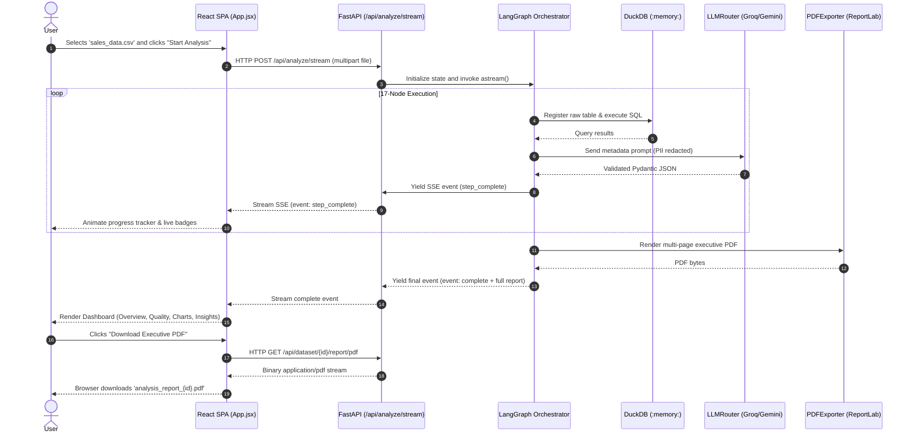

# DataPilot: Multi-Agent AI Data Analysis & Executive Report Generator
## The Master Engineering Blueprint & Educational Guide

---

# 1. Project Overview

### One-Sentence Explanation
**DataPilot** is a production-grade, privacy-preserving multi-agent platform that autonomously cleans raw tabular datasets, executes deterministic mathematical and SQL analytics in an in-memory OLAP database, audits AI-generated insights through an adversarial critic loop, and streams interactive Plotly dashboards and publication-ready PDF reports in real time.

### Beginner Explanation
Imagine you have a messy Excel spreadsheet with hundreds of rows of company data. Some rows are duplicates, some numbers have dollar signs or typos like `-$1,399.98`, some dates say `invalid_date`, and you need to answer critical business questions like *"Which products actually drive our volume?"* and *"Is there a real relationship between discounts and revenue?"*

Normally, you would need:
1. A **data engineer** to clean the spreadsheet, fix typos, and remove corrupt rows.
2. A **database administrator** to import it into SQL and write aggregation queries.
3. A **statistician** to run hypothesis tests, calculate distributions, and ensure you don't confuse correlation with causation.
4. A **business intelligence developer** to build interactive charts and dashboards.
5. A **senior executive or auditor** to fact-check the conclusions so nobody makes business decisions based on hallucinations.
6. A **technical writer** to compile everything into a professional 15-page executive PDF report.

**DataPilot replaces this entire team with a coordinated pipeline of 17 specialized software agents.** You drag and drop your spreadsheet into your web browser, and within 10 seconds, the system sanitizes your data, runs mathematical calculations in an ultra-fast database, produces interactive graphs, double-checks every single claim with an adversarial auditor, and hands you a publication-grade PDF and interactive web report. Crucially, your private data never leaves your computer or gets fed into external AI training sets—only anonymized mathematical summaries are shared with the AI models.

### Technical Explanation
**DataPilot** implements a hybrid deterministic-cognitive multi-agent architecture orchestrated by a **LangGraph StateGraph** and exposed through a **FastAPI** asynchronous backend to a **React 18 / Vite / TailwindCSS** Single Page Application (SPA).

The system enforces a strict architectural boundary between **deterministic computation** (performed by **DuckDB** and **SciPy**) and **probabilistic cognitive reasoning** (performed by Large Language Models via **Groq** and **Google Gemini**):
1. **Deterministic Foundation**: Calculations, quartile distributions, Pearson/Spearman correlation coefficients with two-tailed p-values, one-way ANOVA F-tests, and Pareto concentration metrics are computed entirely on the host CPU using vectorized C/C++ backend kernels. The LLM is never permitted to perform mental arithmetic or calculate metrics.
2. **Zero Raw-Data Leakage**: External LLMs never receive raw row-level records. Prompts receive only compact schema metadata, mathematical distribution moments, and heuristic regex-redacted sample values (masking PII like emails, phone numbers, SSNs, credit cards, and API tokens).
3. **Regex-Guarded SQL Execution**: An LLM generates DuckDB SQL queries based on an adaptive analysis plan. Before execution, queries are validated by a regex-based keyword blocklist that strictly enforces a read-only policy (`SELECT` and `WITH` CTEs only), blocking any filesystem access, data mutation, URL-scheme access, and multi-statement injection chaining. The validator does not parse an abstract syntax tree — it applies text-level word-boundary regex checks and prefix validation.
4. **Adversarial Critic Verification Loop**: To eliminate LLM hallucinations, generated insights pass through an independent `CriticReviewAgent` that cross-examines every numerical claim, causal assertion, and skewness interpretation against computed ground-truth tables. If claims are ungrounded, the critic issues structured correction instructions and triggers an iterative refinement loop (the active LangGraph pipeline allows up to 2 revision cycles).
5. **Real-Time Reactive Streaming**: Progress across all 17 pipeline nodes is streamed to the browser using standard **Server-Sent Events (SSE)**, enabling the frontend to render real-time node progression, intermediate summary badges, and instant interactive visualization mounting.

---

### What Problem Does It Solve?
1. **The LLM Math Hallucination Trap**: If you feed a 5,000-row CSV file directly into a raw LLM like ChatGPT, it will confidently invent numbers, hallucinate averages, fabricate trends, and state causal relationships that do not exist in the underlying data.
2. **Enterprise Data Privacy & Security Risks**: Uploading raw customer tables, financial records, or patient logs to commercial cloud LLMs violates regulations like GDPR, HIPAA, and SOC2. DataPilot operates with a zero-raw-data-leakage architecture.
3. **SQL Injection & Database Corruption**: Autonomous agents that generate and execute SQL against production databases can accidentally drop tables or execute multi-statement injections. DataPilot employs a strict regex-based SQL security guard that validates generated queries against a keyword blocklist and enforces `SELECT`/`WITH`-only policies before execution.
4. **Complex Manual BI Tooling**: Platforms like Tableau and PowerBI require manual data modeling, measure definitions, and visual formatting. DataPilot automates the entire exploratory data analysis (EDA) and reporting workflow.

### Who Would Use It?
- **Data Analysts & Scientists**: To automate initial Exploratory Data Analysis (EDA), data cleaning, and baseline reporting.
- **Product Managers & Business Operators**: To drop in weekly export CSVs and immediately receive actionable insights without waiting on a data team ticket.
- **Executives & C-Suite Leaders**: To obtain publication-grade, fact-checked PDF executive briefings with clear caveats and strategic recommendations.
- **Enterprise Engineering Teams**: As a reference blueprint for building secure, deterministic multi-agent applications with LangGraph and FastAPI.

---

# 2. What Are We Building?

Pretend we have **not written a single line of code yet**. We are sitting with an empty project folder on day one. Here is the engineering specification of what we set out to build:

```text
+-----------------------------------------------------------------------------+
|                          PRODUCT REQUIREMENTS SPEC                          |
+-----------------------------------------------------------------------------+
| 1. FILE INGESTION: Support CSV and Excel (.xlsx, .xls) up to 10 MB.         |
| 2. PRIVACY FILTER: Automatically scrub sensitive PII (emails, SSNs, keys).  |
| 3. DATA CLEANING: Fix encodings, nulls, duplicates, outliers & types.       |
| 4. DATABASE: Load cleaned tables into an in-memory SQL OLAP engine.         |
| 5. STATS ENGINE: Calculate parametric & non-parametric moments & ANOVA.    |
| 6. AGENT WORKFLOW: Coordinate 17 distinct steps via an explicit State Graph. |
| 7. SQL SECURITY: Validate generated queries; block mutations and injections.|
| 8. ADVERSARIAL CRITIC: Reject hallucinations & unsupported causal claims.   |
| 9. VISUALIZATION: Output interactive Plotly charts matching brand palette.  |
| 10. REPORTING: Generate 13-section Markdown and styled ReportLab PDF.       |
| 11. STREAMING: Stream live step-by-step progress via Server-Sent Events.    |
| 12. FRONTEND: Clean React SPA with Glassmorphism tabs and live dashboards.  |
+-----------------------------------------------------------------------------+
```

### Expected Inputs
- A raw file uploaded via HTTP multipart form (`.csv`, `.xlsx`, or `.xls`).
- Datasets ranging from a few dozen rows up to 500,000 rows and 500 columns.
- Messy data containing missing values, whitespace variations, mixed datatypes, duplicate rows, negative values in positive-only columns, and malformed dates.

### Expected Outputs
1. **Cleaned Dataset Artifacts**: A sanitized `.csv` and styled `.xlsx` file available for immediate download.
2. **Interactive Web Dashboard**:
   - **Overview Tab**: Executive KPIs, high-level dataset summary, and questions answered by data.
   - **Data Quality Tab**: 0-100 hygiene score, grade badge (A, B, C, D, F), categorized audit issues.
   - **Clean Data Tab**: Side-by-side before/after metrics, full transformation changelog, and raw preview.
   - **Statistics Tab**: Univariate distribution moments, bivariate correlation matrix, and ANOVA group tests.
   - **Visualizations Tab**: Responsive Plotly charts with custom color palettes and analytical takeaways.
   - **Insights Tab**: 4-part evidence-grounded findings (Finding, Evidence, What this means, Implication).
   - **Report Tab**: 13-section executive report in GitHub markdown with copy-to-clipboard.
3. **Publication-Ready PDF**: A multi-page document rendered with ReportLab featuring running headers, dynamic page counts (`Page X of Y`), tables, and executive styling.

---

# 3. Project Architecture

### Architecture Diagram (Actual System Architecture)

```text
[ USER BROWSER ]
       |
       | 1. Upload CSV/XLSX (HTTP POST multipart)
       v
+-------------------------------------------------------------------------+
| FASTAPI BACKEND SERVER (:8000)                                          |
|                                                                         |
|  [ API Router: /api/analyze/stream ]                                    |
|         |                                                               |
|         | 2. Initialize Workflow State & Launch Async Graph             |
|         v                                                               |
|  [ LANGGRAPH 17-NODE STATEGRAPH ORCHESTRATOR ]                         |
|         |                                                               |
|         +---> Node 1:  FileValidator (Extension, Size, Filename)       |
|         +---> Node 2:  DatasetLoader (Pandas Ingestion & Sanitize)      |
|         +---> Node 3:  DatasetProfiler & QualityChecker (Raw Audit)     |
|         +---> Node 4:  DataCleaner (12-Pass Sanitization Engine)       |
|         |              |--> Caches cleaned CSV to disk & DuckDB         |
|         +---> Node 5:  DatasetUnderstandingAgent (Domain & KPIs)       |
|         +---> Node 6:  AnalysisPlanningAgent (Execution Plan)          |
|         +---> Node 7:  StatisticalEngine (SciPy Moments, Corr, ANOVA)   |
|         +---> Node 8:  SQLGenerationAgent (Synthesize DuckDB SQL)       |
|         +---> Node 9:  SQLValidator (Regex Keyword Blocklist, Read-Only Policy)  |
|         +---> Node 10: SQLExecutor (DuckDB In-Memory Execution)         |
|         +---> Node 11: PatternDetector (Regression, Pareto, Anomalies) |
|         +---> Node 12: ChartGenerator (Plotly JSON Specifications)      |
|         +---> Node 13: InsightGenerationAgent (4-Part Evidence Chain)  |
|         +---> Node 14: CriticReviewAgent (Adversarial Evidence Audit)   |
|         +---> Node 15: ReviseInsightsNode (Conditional Revision Dispatcher)      |
|         |              |--> Loops back to Node 13 if unapproved (see Note below) |
|         +---> Node 16: ReportGenerationAgent (13-Section Markdown)      |
|         +---> Node 17: PDFExporter (ReportLab NumberedCanvas PDF)       |
|                                                                         |
|  [ EXTERNAL / SUBSYSTEM CONNECTIONS ]                                   |
|         |--> DuckDB In-Memory Engine (:memory: OLAP SQL Execution)      |
|         |--> LLMRouter (Failover Pool: Groq -> Gemini -> MockProvider)  |
|         |--> DataPrivacyFilter (Regex PII Redactor)                     |
|         |--> ReportBuilder (Memory Cache + Disk Cache: .cache/)         |
+-------------------------------------------------------------------------+
       |
       | 3. Server-Sent Events (SSE) Progress Stream (text/event-stream)
       |    Backend events: pipeline_start -> step_complete (x17) -> complete
       |    ⚠ NOTE: Frontend currently listens for 'pipeline_complete' — see Known Issues
       v
[ REACT 18 + VITE FRONTEND (:5173) ]
  - PipelineTracker: Live 17-step progress bar with agent labels
  - Tab Navigation: Overview | Quality | Clean Data | Stats | Visuals | Insights | Report
  - Plotly.js Engine: Renders interactive charts from JSON specs
  - Report Exporter: Direct PDF download & Cleaned CSV/Excel export
```

### Component Breakdown & Data Transfer

| From | To | Data Transferred | Protocol / Format | Purpose | What Happens at Stage |
| :--- | :--- | :--- | :--- | :--- | :--- |
| **User Browser** | **FastAPI** | Multipart form containing raw file bytes | HTTP POST (`multipart/form-data`) | Dataset upload | Backend streams file into memory, checks size limit, and assigns a UUID dataset ID. |
| **FastAPI** | **LangGraph** | `AnalysisWorkflowState` dictionary | In-memory Python Dict | Pipeline invocation | `analysis_workflow_graph.astream()` starts executing nodes sequentially. |
| **Node 1-2** | **DuckDB** | Pandas DataFrame | In-memory pointer (`register()`) | SQL Table Registration | Registers `raw_dataset_<id>` in memory without writing to disk. |
| **Node 3-4** | **DataCleaner** | Raw DataFrame | Python DataFrame | 12-Pass Sanitization | Strips control characters, normalizes dates, imputes missing values, reconciles cross-field math, registers `dataset_<id>` in DuckDB. |
| **Node 5-6** | **LLMRouter** | Sanitized column schema & metadata strings | JSON prompt via HTTPS | Cognitive Domain & Plan Synthesis | External LLM (Groq Llama 3.3 or Gemini 2.5 Flash) returns validated Pydantic models. |
| **Node 7-10** | **DuckDB & SciPy** | Cleaned DataFrame & SQL strings | Vectorized memory calls | Deterministic Analysis | Computes exact moments, ANOVA p-values, and runs validated SQL queries. |
| **Node 11-12**| **Plotly Specs** | Statistical records & role profiles | JSON Spec Dictionaries | Chart Generation | Infers column roles (measures vs categories) and builds complete Plotly trace/layout specs. |
| **Node 13-15**| **Critic Loop** | Evidence summaries & Insight lists | Pydantic Models | Adversarial Fact-Checking | Critic validates every insight against ground-truth tables; triggers revision if claims are ungrounded. |
| **Node 16-17**| **ReportLab** | `AnalysisReport` object | Python Objects | PDF Compilation | Compiles 13 Markdown sections and renders a downloadable binary PDF buffer. |
| **FastAPI** | **React Frontend**| JSON event payloads | Server-Sent Events (`text/event-stream`) | Real-Time Execution Feedback | Frontend listens to `step_complete` events and updates the progress tracker dynamically. |

---

# 4. Complete Folder Structure

Here is the complete physical file structure of the repository:

```text
multi-agent-ai-data-analysis-assistant/
│
├── .gitignore                          # Git ignore rules (caches, venvs, env files)
├── PROJECT_STATE.md                    # Project development phase tracker (0 to 11)
├── README.md                           # Project public landing documentation
├── render.yaml                         # Render Infrastructure-as-Code deployment blueprint (backend web service + frontend static site)
├── overview.md                         # (This file) Complete reverse-engineered educational master guide
│
├── backend/                            # Python FastAPI Backend Root
│   ├── .env                            # Active environment variables & API keys
│   ├── .env.example                    # Template environment variable configuration
│   ├── .python-version                 # Locked Python version specification (3.11.9)
│   ├── requirements.txt                # Pinned Python package dependencies
│   ├── __init__.py                     # Root backend package marker
│   │
│   ├── app/                            # Application Core Source Code
│   │   ├── __init__.py                 # Application package marker
│   │   ├── main.py                     # FastAPI entry point, CORS, lifespan & error handlers
│   │   │
│   │   ├── core/                       # Foundational Infrastructure Utilities
│   │   │   ├── config.py               # Pydantic BaseSettings environment configuration
│   │   │   ├── exceptions.py           # Application custom exception hierarchy
│   │   │   └── logging.py              # Centralized logging configuration & stream handler
│   │   │
│   │   ├── llm/                        # Multi-Provider LLM Gateway Layer
│   │   │   ├── base.py                 # Abstract base class LLMProvider
│   │   │   ├── groq_provider.py        # Groq Llama-3.3-70b structured output client
│   │   │   ├── gemini_provider.py      # Google Gemini-2.5-flash structured output client
│   │   │   ├── mock_provider.py        # High-fidelity deterministic mock LLM provider
│   │   │   ├── privacy.py              # DataPrivacyFilter regex PII redaction filter
│   │   │   └── router.py               # Failover router, credential pools & rate-limit cooldowns
│   │   │
│   │   ├── models/                     # Pydantic Domain Schemas & Data Contracts
│   │   │   ├── dataset.py              # ColumnSchema, DatasetMetadata, UploadResponse
│   │   │   ├── profile.py              # ColumnProfile, NumericStats, CategoricalStats, DatasetProfile
│   │   │   ├── quality.py              # QualityIssue, QualitySeverity, QualityReport
│   │   │   ├── cleaning.py             # ChangeLogEntry, BeforeAfterSummary, CleaningSummary
│   │   │   ├── understanding.py        # KPICandidate, DimensionCandidate, DatasetUnderstanding
│   │   │   ├── plan.py                 # GroupByAnalysisPlan, SQLQueryGoal, AnalysisPlan
│   │   │   ├── statistics.py           # UnivariateMetric, CorrelationPairResult, StatisticalAnalysisResult
│   │   │   ├── sql.py                  # GeneratedSQLQuery, SQLExecutionResult, SQLAnalysisResult
│   │   │   ├── patterns.py             # TrendPattern, ParetoConcentrationPattern, PatternDetectionResult
│   │   │   ├── visualization.py        # PlotlyChartSpec, ChartCollection
│   │   │   ├── insights.py             # InsightItem (4-part evidence chain), InsightCollection
│   │   │   ├── critic.py               # UnsupportedClaim, CriticReviewResult
│   │   │   └── report.py               # ReportSection, GeneratedReportMarkdown, AnalysisReport
│   │   │
│   │   ├── services/                   # Deterministic Analytical & Computational Engines
│   │   │   ├── ingestion/              # Ingestion, validation & DuckDB registration
│   │   │   │   ├── validator.py        # FileValidator (size, extension, path traversal sanitization)
│   │   │   │   ├── loader.py           # DatasetLoader (multi-encoding CSV/Excel parser)
│   │   │   │   └── duckdb_manager.py   # DuckDBManager (:memory: OLAP session & DataFrame registration)
│   │   │   ├── profiling/              # Profiling engine
│   │   │   │   └── profiler.py         # DatasetProfiler (semantic types, moments, value frequencies)
│   │   │   ├── quality/                # Quality evaluation
│   │   │   │   └── checker.py          # QualityChecker (duplicates, outliers, label inconsistencies)
│   │   │   ├── cleaning/               # Enterprise sanitization
│   │   │   │   └── cleaner.py          # DataCleaner (12-pass sanitization, range checks, changelog)
│   │   │   ├── statistics/             # Statistical engine
│   │   │   │   └── engine.py           # StatisticalEngine (moments, Pearson/Spearman, one-way ANOVA)
│   │   │   ├── sql/                    # SQL security & execution
│   │   │   │   ├── validator.py        # SQLValidator (regex keyword blocklist, read-only policy, URL detection)
│   │   │   │   └── executor.py         # SQLExecutor (safe execution, syntax repair, intent mismatch checks)
│   │   │   ├── patterns/               # Pattern detection
│   │   │   │   └── detector.py         # PatternDetector (linear regression, Pareto 80/20, Z-score anomalies)
│   │   │   ├── visualization/          # Intelligent plotting
│   │   │   │   ├── role_classifier.py  # SemanticRoleClassifier (measures, categories, temporal, keys)
│   │   │   │   └── chart_generator.py  # ChartGenerator (domain-adaptive Plotly JSON compilation)
│   │   │   └── reporting/              # Document compilation & PDF export
│   │   │       ├── report_builder.py   # ReportBuilder (disk/memory caching & session history)
│   │   │       └── pdf_exporter.py     # PDFExporter (ReportLab multi-page executive PDF renderer)
│   │   │
│   │   ├── agents/                     # Cognitive LLM Agents (Prompt Engineering & Reasoning)
│   │   │   ├── understand_dataset.py   # DatasetUnderstandingAgent (domain, entity, candidate KPIs)
│   │   │   ├── plan_analysis.py        # AnalysisPlanningAgent (executable plan & hallucination scrubber)
│   │   │   ├── generate_sql.py         # SQLGenerationAgent (synthesizes DuckDB SELECT/CTE queries)
│   │   │   ├── generate_insights.py    # InsightGenerationAgent (4-part evidence-grounded insights)
│   │   │   ├── critic_review.py        # CriticReviewAgent (adversarial ground-truth verification)
│   │   │   ├── revise_insights.py      # InsightRevisionOrchestrator (standalone generation+critic loop helper)
│   │   │   └── generate_report.py      # ReportGenerationAgent (13-section publication Markdown report)
│   │   │
│   │   ├── orchestration/              # LangGraph Workflow DAG & Streaming
│   │   │   ├── state.py                # AnalysisWorkflowState (TypedDict state container)
│   │   │   ├── events.py               # STEP_METADATA (17-node metadata), format_sse_event & clean_nan_and_inf helpers
│   │   │   └── graph.py                # StateGraph assembly, node functions, conditional edges & compilation
│   │   │
│   │   └── api/                        # REST API Routes & Endpoints
│   │       ├── dependencies.py         # Common FastAPI dependencies
│   │       └── routes/
│   │           ├── health.py           # GET /api/health
│   │           ├── upload.py           # POST /api/upload
│   │           ├── profile.py          # GET /api/dataset/{id}/profile, /quality
│   │           ├── analysis.py         # POST /api/analyze/stream (17-Node SSE stream)
│   │           └── report.py           # GET/DELETE /api/dataset/history, report retrieval & PDF export
│   │
│   ├── temp_uploads/                   # Temporary directory for uploaded CSV/Excel files
│   └── tests/                          # Pytest Automated Test Suite (75 Tests across 21 files)
│       ├── test_agents.py
│       ├── test_cleaning.py
│       ├── test_critic.py
│       ├── test_e2e_pipeline.py
│       ├── test_graph.py
│       ├── test_health.py
│       ├── test_history.py
│       ├── test_ingestion.py
│       ├── test_insights.py
│       ├── test_llm_router.py
│       ├── test_patterns.py
│       ├── test_pdf_export.py
│       ├── test_profiling.py
│       ├── test_quality.py
│       ├── test_report.py
│       ├── test_revision_loop.py
│       ├── test_sql_execution.py
│       ├── test_sql_safety.py
│       ├── test_sse_stream.py
│       ├── test_statistics.py
│       └── test_visualizations.py
│
├── frontend/                           # React 18 + Vite Frontend Application Root
│   ├── .env                            # Frontend environment variables (VITE_API_BASE_URL)
│   ├── .env.example                    # Template frontend environment configuration
│   ├── index.html                      # HTML5 root shell, meta tags & web fonts
│   ├── package.json                    # NPM package dependencies and scripts
│   ├── postcss.config.js               # PostCSS configuration for TailwindCSS
│   ├── tailwind.config.js              # Custom branding palette & theme tokens
│   ├── vite.config.js                  # Vite bundler configuration
│   ├── public/                         # Static assets & favicon.svg
│   │
│   └── src/                            # React Application Source Code
│       ├── main.jsx                    # React entry point mounting App to DOM root
│       ├── App.jsx                     # Top-level state machine, SSE streaming reader & navigation
│       ├── index.css                   # Tailwind directives, design system variables & glass-cards
│       │
│       ├── services/
│       │   └── apiConfig.js            # Dynamic API base URL resolver (Cloud / Localhost inference)
│       │
│       └── components/                 # UI Modular Tab & Display Components
│           ├── OverviewTab.jsx         # Executive summary, KPI cards & questions answered by data
│           ├── DataQualityTab.jsx      # Cleanliness health gauge, audit issues & recommendations
│           ├── CleanDataTab.jsx        # Before/after audit, full changelog & cleaned table preview
│           ├── StatisticsTab.jsx       # Univariate distribution moments, correlations & ANOVA tests
│           ├── VisualizationsTab.jsx   # Grid of interactive charts with category filtering
│           ├── ChartRenderer.jsx       # Plotly canvas wrapper with dynamic resize listeners
│           ├── InsightsTab.jsx         # 4-part evidence cards with confidence badges
│           ├── ReportMarkdownTab.jsx   # 13-section Markdown report viewer with copy action
│           ├── PipelineTracker.jsx     # Real-time 17-node SSE animated progress tracker
│           ├── HistorySidebar.jsx      # Session drawer of past analyzed datasets
│           ├── SnowfallBackground.jsx  # Elegant ambient particle background animation
│           └── ErrorBoundary.jsx       # React component error catcher & recovery interface
│
└── samples/                            # Benchmark & Sample Test Datasets
    ├── README.md                       # Documentation of sample files
    ├── clean_dataset.csv               # Baseline clean retail transactions (20 rows)
    ├── clean_dataset.xlsx              # Excel equivalent for testing binary ingestion
    ├── messy_dataset.csv               # Corrupted dataset (nulls, duplicates, outliers, invalid dates)
    └── student_scores.csv              # Educational domain dataset for multi-domain validation
```

---


# 5. File-by-File Explanation (Part 1: Core, LLM & Data Models)

Every line of code in this system has a deliberate purpose. Below is the comprehensive, line-by-line breakdown of each source code file.

---

## `backend/app/main.py`

### Purpose
This is the master entry point of the FastAPI backend application. It initializes the web server, configures dynamic Python import paths, registers Cross-Origin Resource Sharing (CORS) middleware, attaches global exception handlers, binds the application lifespan event, and mounts all REST API routers.

### What It Contains
- Dynamic path resolution modifying `sys.path`.
- `lifespan(app: FastAPI)` asynchronous context manager for server startup and shutdown logging.
- `app = FastAPI(...)` application instance.
- CORS middleware configuration supporting wildcard regex and explicit origin lists.
- Global exception handlers for `AppBaseException` and unhandled standard exceptions.
- Router mounts: `health_router`, `upload_router`, `profile_router`, `report_router`, and `analysis_router`.
- Root route `GET /` returning system metadata and health links.

### Dependencies
```python
import sys
import os
from contextlib import asynccontextmanager
from fastapi import FastAPI, Request
from fastapi.middleware.cors import CORSMiddleware
from fastapi.responses import JSONResponse
from backend.app.core.config import settings
from backend.app.core.logging import logger
from backend.app.core.exceptions import AppBaseException
from backend.app.api.routes.health import router as health_router
from backend.app.api.routes.upload import router as upload_router
from backend.app.api.routes.profile import router as profile_router
from backend.app.api.routes.report import router as report_router
from backend.app.api.routes.analysis import router as analysis_router
```
- `sys` & `os`: Built-in Python modules used to inspect filesystem paths and dynamically add the workspace root to Python's module resolution list (`sys.path`).
- `asynccontextmanager`: Enables the modern FastAPI `lifespan` protocol, replacing deprecated `@app.on_event("startup")` hooks.
- `FastAPI`: High-performance asynchronous ASGI web framework built on Starlette and Pydantic.
- `CORSMiddleware`: Security layer that permits web browsers running on different ports (e.g. Vite on `:5173`) to make asynchronous HTTP requests to this backend on `:8000`.
- `JSONResponse`: Serializes Python dictionaries directly into HTTP JSON responses with custom status codes.
- `settings`, `logger`, `AppBaseException`: Core configuration, logging, and exception primitives defined in `backend/app/core/`.
- Router imports: Modular sub-routers handling specific domain endpoints.

### Code Explanation

#### Dynamic Path Resolution
```python
_current_file = os.path.abspath(__file__)
_app_dir = os.path.dirname(_current_file)
_backend_dir = os.path.dirname(_app_dir)
_project_root = os.path.dirname(_backend_dir)
for _p in [_project_root, _backend_dir]:
    if _p not in sys.path:
        sys.path.insert(0, _p)
```
- **Line 5-8**: Computes absolute directory paths starting from `backend/app/main.py`, traversing up to `backend/app/`, `backend/`, and the repository root.
- **Line 9-11**: Inserts these directories at the very front of `sys.path` (index 0).
- **Why?**: When running the server via `uvicorn app.main:app` from the `backend/` directory or `uvicorn backend.app.main:app` from the root, Python can encounter `ModuleNotFoundError: No module named 'backend'`. This explicit path insertion guarantees that imports starting with `backend.app...` succeed regardless of what working directory the developer was in when they launched the terminal command.

#### Lifespan & App Creation
```python
@asynccontextmanager
async def lifespan(app: FastAPI):
    logger.info(f"Starting {settings.APP_NAME} v{settings.APP_VERSION} in {settings.APP_ENV} mode")
    yield
    logger.info(f"Shutting down {settings.APP_NAME}")

app = FastAPI(
    title=settings.APP_NAME,
    version=settings.APP_VERSION,
    description="Multi-Agent CSV/Excel Insight & Report Generator API",
    lifespan=lifespan
)
```
- `asynccontextmanager`: Defines setup logic before the `yield` (executes when the web server boots up) and teardown logic after the `yield` (executes when you press `Ctrl+C` to stop the server).
- `app = FastAPI(...)`: Creates the ASGI application instance. The OpenAPI interactive documentation is automatically generated at `/docs` using these titles and versions.

#### Flexible CORS Middleware
```python
origins = settings.CORS_ORIGINS if isinstance(settings.CORS_ORIGINS, list) else [settings.CORS_ORIGINS]
is_wildcard = "*" in origins

if is_wildcard:
    app.add_middleware(
        CORSMiddleware,
        allow_origins=[],
        allow_origin_regex=".*",
        allow_credentials=True,
        allow_methods=["*"],
        allow_headers=["*"],
    )
```
- In HTTP, if a website on `http://localhost:5173` tries to fetch data from `http://localhost:8000`, the browser blocks it by default to prevent cross-site request forgery.
- If `CORS_ORIGINS` is configured to `*` (as in production cloud deployments on Render), the server uses `allow_origin_regex=".*"` because standard W3C CORS specifications do not allow `allow_origins=["*"]` when `allow_credentials=True`. This design pattern avoids browser CORS rejections.

#### Global Exception Handling
```python
@app.exception_handler(AppBaseException)
async def app_exception_handler(request: Request, exc: AppBaseException):
    logger.error(f"Application error on {request.url.path}: {exc.message}")
    return JSONResponse(
        status_code=400,
        content={"error": exc.__class__.__name__, "message": exc.message, "details": exc.details}
    )
```
- Catches any domain exception derived from `AppBaseException` (like file size limits, SQL syntax violations, or parsing failures) and returns a clean HTTP 400 Bad Request JSON instead of crashing the server or emitting an ugly raw HTML traceback.

### Inputs, Processing & Outputs
- **Inputs**: HTTP requests over TCP from client browsers or curl commands.
- **Processing**: Routes requests to specific route handlers, catches exceptions, applies CORS headers.
- **Outputs**: HTTP responses (JSON, SSE streams, binary PDF buffers, CSV/Excel streams).
- **Used By**: Uvicorn server launcher (`uvicorn app.main:app`).
- **Calls**: All API routes and core config/logging.
- **Beginner Summary**: This file is the front door of the backend. It sets up the server, unlocks the doors for the frontend (CORS), and directs visitors to the right hallway (routers).

---

## `backend/app/core/config.py`

### Purpose
Defines the centralized configuration schema and environment variable loader for the entire backend application using Pydantic Settings.

### What It Contains
- `Settings(BaseSettings)` class.
- Configuration fields with default values:
  - `APP_ENV`: `"development"` or `"production"`.
  - `PORT`: Server port (default `8000`).
  - Limits: `MAX_UPLOAD_SIZE_MB = 10`, `MAX_DATASET_ROWS = 500000`, `MAX_DATASET_COLUMNS = 500`.
  - API Credentials: `GROQ_API_KEY_1`, `GROQ_API_KEY_2`, `GROQ_API_KEY_3`, `GEMINI_API_KEY_1`, `GEMINI_API_KEY_2`.
  - Model identifiers: `GROQ_MODEL = "llama-3.3-70b-versatile"`, `GEMINI_MODEL = "gemini-2.5-flash"`.
  - CORS configurations with automated JSON string/list validator.
- Singleton instance: `settings = Settings()`.

### Code Explanation
```python
class Settings(BaseSettings):
    APP_ENV: str = "development"
    APP_NAME: str = "DataPilot:Multi-Agent Data Analyst API"
    APP_VERSION: str = "1.0.0"
    LOG_LEVEL: str = "INFO"
    HOST: str = "0.0.0.0"
    PORT: int = 8000

    # Limits
    MAX_UPLOAD_SIZE_MB: int = 10
    MAX_DATASET_ROWS: int = 500000
    MAX_DATASET_COLUMNS: int = 500

    # Groq Settings
    GROQ_API_KEY_1: str = ""
    GROQ_API_KEY_2: str = ""
    GROQ_API_KEY_3: str = ""
    GROQ_MODEL: str = "llama-3.3-70b-versatile"

    # Gemini Settings
    GEMINI_API_KEY_1: str = ""
    GEMINI_API_KEY_2: str = ""
    GEMINI_MODEL: str = "gemini-2.5-flash"
    
    model_config = SettingsConfigDict(
        env_file=".env",
        env_file_encoding="utf-8",
        extra="ignore"
    )
```
- `BaseSettings`: Reads environment variables from the OS or from a `.env` file in the current directory.
- `extra="ignore"`: If your `.env` contains unexpected keys, it silently ignores them instead of crashing.
- Multiple keys (`GROQ_API_KEY_1`, `2`, `3`): Establishes a round-robin / failover credential pool so if one key hits a rate limit (HTTP 429), the LLM router can switch to the next key automatically.

```python
@field_validator("CORS_ORIGINS", mode="before")
@classmethod
def parse_cors_origins(cls, v: Union[List[str], str]) -> List[str]:
    if isinstance(v, str):
        v_stripped = v.strip()
        if v_stripped == "*":
            return ["*"]
        if v_stripped.startswith("[") and v_stripped.endswith("]"):
            try:
                return json.loads(v_stripped)
            except Exception:
                pass
        return [origin.strip() for origin in v.split(",") if origin.strip()]
    return v
```
- In `.env`, CORS origins might be entered as a JSON array `["http://localhost:5173"]`, a comma-separated string `http://localhost:5173, http://localhost:3000`, or a wildcard `*`. This validator sanitizes any of these formats into a clean Python `List[str]`.

- **Beginner Summary**: This file reads your `.env` file and turns your secret API keys and server settings into clean, type-checked Python variables accessible anywhere via `settings.KEY_NAME`.

---

## `backend/app/core/exceptions.py`

### Purpose
Declares the custom domain exception hierarchy for the application.

### What It Contains
- `AppBaseException(Exception)`: Root base exception with `message` and optional `details`.
- `FileValidationError(AppBaseException)`: Raised when an uploaded file violates size, extension, or format rules.
- `IngestionError(AppBaseException)`: Raised when CSV decoding or DuckDB table creation fails.
- `LLMProviderError(AppBaseException)`: Raised when Groq or Gemini fail or return malformed outputs.
- `SQLSecurityError(AppBaseException)`: Raised when generated SQL contains dangerous keywords or injection attempts.

### Code Explanation
```python
class AppBaseException(Exception):
    '''Base exception for application errors.'''
    def __init__(self, message: str, details: Optional[Any] = None):
        super().__init__(message)
        self.message = message
        self.details = details
```
- By deriving all custom exceptions from `AppBaseException`, the single exception handler in `main.py` can catch any application-level error and present a structured error JSON to the frontend.

- **Beginner Summary**: Instead of letting Python crash with a mysterious traceback when something goes wrong, these custom errors give clear, categorized reasons for the failure.

---

## `backend/app/core/logging.py`

### Purpose
Configures standard Python logging with a structured format and timestamping.

### Code Explanation
```python
def setup_logging() -> logging.Logger:
    log_format = "%(asctime)s | %(levelname)-8s | %(name)s:%(funcName)s:%(lineno)d - %(message)s"
    date_format = "%Y-%m-%d %H:%M:%S"
    level = getattr(logging, settings.LOG_LEVEL.upper(), logging.INFO)

    logging.basicConfig(
        level=level,
        format=log_format,
        datefmt=date_format,
        handlers=[logging.StreamHandler(sys.stdout)]
    )
    logger = logging.getLogger("multi_agent_data_analyst")
    logger.setLevel(level)
    return logger

logger = setup_logging()
```
- Outputs to `sys.stdout` so logs can be captured by cloud logging agents (like Render or Docker).
- Displays timestamp, log severity level (`INFO`, `WARNING`, `ERROR`), file name, function name, and exact line number, making debugging trivial.

---

## `backend/app/llm/base.py`

### Purpose
Defines the abstract interface that every LLM provider (Groq, Gemini, Mock) must implement.

### Code Explanation
```python
from abc import ABC, abstractmethod
from typing import List, Dict, Type, TypeVar
from pydantic import BaseModel

T = TypeVar("T", bound=BaseModel)

class LLMProvider(ABC):
    @property
    @abstractmethod
    def provider_name(self) -> str:
        pass

    @abstractmethod
    def generate_structured(
        self,
        messages: List[Dict[str, str]],
        response_model: Type[T],
        temperature: float = 0.1,
    ) -> T:
        pass
```
- Uses Python's `abc.ABC` (Abstract Base Class).
- `generate_structured`: Guarantees that no matter what AI provider is used underneath, the caller always passes standard chat messages and a Pydantic class (`response_model`), and always receives a validated, typed instance of that class back.

---

## `backend/app/llm/privacy.py`

### Purpose
Implements the heuristic data redaction engine that guarantees zero raw-data leakage of sensitive Personally Identifiable Information (PII) to external cloud AI providers.

### Code Explanation
```python
class DataPrivacyFilter:
    EMAIL_REGEX = re.compile(r"[a-zA-Z0-9._%+-]+@[a-zA-Z0-9.-]+\.[a-zA-Z]{2,}", re.IGNORECASE)
    PHONE_REGEX = re.compile(r"(?:\+?\d{1,3}[-.\s]?)?\(?\d{3}\)?[-.\s]?\d{3}[-.\s]?\d{4}")
    SSN_REGEX = re.compile(r"\d{3}-\d{2}-\d{4}")
    CREDIT_CARD_REGEX = re.compile(r"(?:\d{4}[-\s]?){3}\d{4}")
    API_KEY_REGEX = re.compile(r"(?:api[_-]?key|secret|token|bearer|password)[=:\s]+[A-Za-z0-9_\-\.]{8,}", re.IGNORECASE)

    @classmethod
    def redact_text(cls, text: str) -> str:
        if not text or not isinstance(text, str):
            return text
        redacted = cls.EMAIL_REGEX.sub("[EMAIL_REDACTED]", text)
        redacted = cls.PHONE_REGEX.sub("[PHONE_REDACTED]", redacted)
        redacted = cls.SSN_REGEX.sub("[SSN_REDACTED]", redacted)
        redacted = cls.CREDIT_CARD_REGEX.sub("[CARD_REDACTED]", redacted)
        redacted = cls.API_KEY_REGEX.sub("[SECRET_REDACTED]", redacted)
        return redacted
```
- Every sample value or prompt message sent to Groq or Gemini passes through `redact_text`.
- If a dataset contains a column with customer emails or credit cards, the LLM only ever sees `[EMAIL_REDACTED]` or `[CARD_REDACTED]`.

---

## `backend/app/llm/router.py`

### Purpose
The intelligent gateway that handles multi-provider failover, API credential rotation, health tracking, rate-limit cooldowns, and automatic fallback to a deterministic mock generator.

### Code Explanation
```python
class LLMRouter:
    _instance: Optional["LLMRouter"] = None

    def __init__(self):
        self.cooldown_duration_seconds = 60.0
        self.cooldowns: Dict[str, float] = {}  # provider_key_id -> expiration_timestamp
        self.mock_provider = MockLLMProvider()
```
- **Singleton Pattern**: Ensures only one router instance exists, sharing cooldown timers across all requests.
- **Cooldown Tracking**: If Groq returns an HTTP 429 (Rate Limit Exceeded), `mark_cooldown("groq_key_1")` records the current time plus 60 seconds. For the next 60 seconds, no requests will waste time attempting to use that key.

```python
def complete(self, agent_name: str, messages: List[Dict[str, str]], response_model: Type[T], temperature: float = 0.1) -> T:
    sanitized_messages = [
        {"role": m["role"], "content": DataPrivacyFilter.redact_text(m["content"])}
        for m in messages
    ]
    available_providers = self._get_available_providers()

    if not available_providers:
        logger.info(f"[{agent_name}] No external LLM keys available or all on cooldown. Using MockLLMProvider.")
        return self.mock_provider.generate_structured(...)
        
    for key_id, provider in available_providers:
        try:
            return provider.generate_structured(...)
        except LLMProviderError as pe:
            if "rate" in str(pe).lower() or "429" in str(pe):
                self.mark_cooldown(key_id)
            continue
```
1. Redacts sensitive PII from messages.
2. Gathers available healthy providers (Groq keys first, then Gemini keys).
3. If no keys exist in `.env`, it falls back to `MockLLMProvider` immediately.
4. If a provider fails, it marks a cooldown and tries the next provider in line.
5. If all external APIs fail, it falls back to `MockLLMProvider` so the pipeline never crashes.

---

## `backend/app/llm/groq_provider.py` & `gemini_provider.py`

### Purpose
Wrappers around the Groq SDK (`groq`) and Google GenAI SDK (`google.genai`) implementing strict JSON schema enforcement.

### Key Mechanism
- **Groq**: Uses `response_format={"type": "json_object"}` and injects the Pydantic schema (`response_model.model_json_schema()`) into the system instruction. The returned JSON string is validated via `response_model.model_validate_json()`.
- **Gemini**: Uses `response_mime_type="application/json"` and passes `response_schema=response_model` directly to the `types.GenerateContentConfig`.

---

## `backend/app/llm/mock_provider.py`

### Purpose
A deterministic, high-fidelity offline LLM emulator.

### Why It Exists
Enables the entire test suite (75 tests), local development, and offline demonstrations to execute with 100% functionality without requiring active API keys or an internet connection.

### How It Works
It parses the prompt text using regex, detects the business domain (e.g. searching for keywords like "patient" -> Healthcare, "employee" -> HR, "revenue" -> Sales), extracts real column names from the prompt, and generates synthetically valid Pydantic models for `DatasetUnderstanding`, `AnalysisPlan`, `GeneratedSQL`, `InsightList`, `CriticEvaluation`, and `FinalReport`.

---

## `backend/app/models/` (Pydantic Domain Schemas)

These files define the strict data contracts that flow through the system:

1. **`dataset.py`**:
   - `ColumnSchema`: Sanitized column name (`name`), original header (`original_name`), inferred data type (`dtype`), null count (`null_count`), and non-sensitive sample values (`sample_values: List[Any]`).
   - `DatasetMetadata`: Master dataset metadata envelope containing:
     - `dataset_id: str`: Unique UUID identifier for this dataset.
     - `table_name: str`: Sanitized DuckDB table name (`dataset_<sanitized_uuid>`).
     - `filename: str`: Original filename uploaded by user.
     - `file_size_bytes: int`: File size in bytes.
     - `row_count: int`: Total row count.
     - `column_count: int`: Total column count.
     - `columns: List[ColumnSchema]`: Ordered list of all column schemas.
     - `preview_rows: List[Dict[str, Any]]`: Top preview records (e.g. 5–10 rows) for instant frontend table rendering.
     - `upload_timestamp: str`: ISO-8601 formatted upload timestamp.
   - `UploadResponse`: Response envelope for `/api/upload` endpoint (`success: bool`, `message: str`, `dataset: DatasetMetadata`).

2. **`profile.py`**:
   - `NumericStats`: Min, max, mean, median, std, q25, q75, IQR, skewness.
   - `CategoricalStats`: Unique counts, cardinality, top 3 value frequencies.
   - `ColumnProfile`: Complete semantic profile for one column.
   - `DatasetProfile`: Entire dataset profile containing column profile lists.

3. **`quality.py`**:
   - `QualitySeverity`: Enum (`confirmed_issue`, `suspicious_issue`, `informational`).
   - `QualityIssue`: ID, category (e.g. `outliers`, `duplicate_rows`), severity, affected counts, and suggested remediation.
   - `QualityReport`: 0-100 overall score, letter grade (A-F), issue tallies, analysis-readiness flag.

4. **`cleaning.py`**:
   - `ChangeLogEntry`: Row-level change audit (original value, new value, rule applied, confidence score, assumption flag).
   - `BeforeAfterSummary`: Comparative before-and-after audit metrics (missingness rate drop, out-of-range corrections, duplicate count).
   - `CleaningSummary`: Complete contract returned by `DataCleaner`.

5. **`understanding.py`**:
   - `KPICandidate`: Candidate metrics for aggregation (SUM, AVG) and business importance.
   - `DimensionCandidate`: Segmentation columns and roles.
   - `DatasetUnderstanding`: Domain, entity description, core questions.

6. **`plan.py`**:
   - `GroupByAnalysisPlan`: Group column, metric column, aggregation type, business purpose.
   - `SQLQueryGoal`: Query identifier and required columns.
   - `AnalysisPlan`: Executable strategy formulated by the planning agent.

7. **`statistics.py`**:
   - `UnivariateMetric`: Parametric and non-parametric moments, skewness, plain-English summary.
   - `CorrelationPairResult`: Pearson and Spearman coefficients, p-values, direction, strength, practical effect size, causality warning.
   - `GroupByResult`: Aggregation breakdown and one-way ANOVA F-statistic and p-value.
   - `StatisticalAnalysisResult`: Complete collection of statistical tests.

8. **`sql.py`**:
   - `GeneratedSQLQuery`: Query name, purpose, DuckDB SQL string, expected column aliases.
   - `SQLExecutionResult`: Execution status (`success`, `failed`), duration in ms, row count, column names, preview rows, validation warnings.
   - `SQLAnalysisResult`: Collection of all executed queries.

9. **`patterns.py`**:
   - `TrendPattern`: Direction, slope, R², p-value, growth rate %, statistical significance.
   - `ParetoConcentrationPattern`: Top category share %, true Pareto boolean flag, label.
   - `AnomalyPattern`: Z-score, deviation factor, severity, row identifier.
   - `PatternDetectionResult`: Summary of discovered trends, concentrations, and outliers.

10. **`visualization.py`**:
    - `PlotlyChartSpec`: Full Plotly JSON specification (data traces, layout, config, analytical takeaway badge).
    - `ChartCollection`: List of charts generated for the dataset.

11. **`insights.py`**:
    - `InsightItem`: Mandatory 4-part evidence chain:
      - `title`: Headline summary.
      - `finding`: Core observation grounded in data.
      - `evidence`: Exact numbers, percentages, correlations, or SQL figures.
      - `what_this_means`: Plain-English explanation for non-technical users.
      - `interpretation`: Business implication.
      - `implication` / `recommendation`: Prudent next steps (`review`, `investigate`, `monitor`).
      - `confidence`: `High`, `Moderate`, `Low`, or `Caveat` with rationale.
      - `statistical_vs_practical`: Clarification of effect size vs p-value.
    - `InsightCollection`: List of insights and executive bullet takeaways.

12. **`critic.py`**:
    - `UnsupportedClaim`: Insight ID, flagged text, reason for rejection, ground-truth fact.
    - `CriticReviewResult`: `approved` boolean, review feedback, list of unsupported claims, concrete required corrections.

13. **`report.py`**:
    - `ReportSection`: ID, title, summary, Markdown content.
    - `GeneratedReportMarkdown`: 13 canonical sections of the executive report.
    - `AnalysisReport`: Master report document aggregating all metadata, sections, charts, insights, and clean summaries.

---


# 5. File-by-File Explanation (Part 2: Deterministic Analytical Services)

The `backend/app/services/` directory contains the deterministic engines of DataPilot. These services perform all data ingestion, mathematical computations, database operations, chart generation, and document rendering with zero LLM guesswork.

---

## `backend/app/services/ingestion/validator.py`

### Purpose
Performs strict pre-flight validation on uploaded file metadata before allowing files into memory, protecting the server from denial-of-service and directory traversal exploits.

### What It Contains
- `ALLOWED_EXTENSIONS = {".csv", ".xlsx", ".xls"}`
- `FileValidator.sanitize_filename(filename: str) -> str`
- `FileValidator.validate_file_metadata(filename: str, file_size: int, content_type: str = "") -> Tuple[str, str]`

### Code Explanation
```python
@staticmethod
def sanitize_filename(filename: str) -> str:
    if not filename:
        raise FileValidationError("Filename cannot be empty")
    base = os.path.basename(filename)
    sanitized = re.sub(r"[^a-zA-Z0-9._-]", "_", base)
    if not sanitized or sanitized.startswith("."):
        sanitized = f"upload_{sanitized}".lstrip(".")
    return sanitized
```
- `os.path.basename`: Strips directory path prefixes (e.g. `../../etc/passwd` becomes `passwd`).
- `re.sub(r"[^a-zA-Z0-9._-]", "_", base)`: Replaces spaces and shell characters with safe underscores.

```python
@staticmethod
def validate_file_metadata(filename: str, file_size: int, content_type: str = "") -> Tuple[str, str]:
    sanitized_name = FileValidator.sanitize_filename(filename)
    _, ext = os.path.splitext(sanitized_name.lower())

    if ext not in ALLOWED_EXTENSIONS:
        raise FileValidationError(f"Unsupported file format '{ext}'.")
    if file_size <= 0:
        raise FileValidationError("The uploaded file is empty (0 bytes).")
    max_bytes = settings.MAX_UPLOAD_SIZE_MB * 1024 * 1024
    if file_size > max_bytes:
        raise FileValidationError(f"File size exceeds maximum allowed limit of {settings.MAX_UPLOAD_SIZE_MB} MB.")
    return sanitized_name, ext
```
- Verifies extension whitelist (`.csv`, `.xlsx`, `.xls`).
- Rejects 0-byte uploads immediately.
- Enforces strict file size limit (default 10 MB from `settings.MAX_UPLOAD_SIZE_MB`).
- **Parameter Usage Note**: `content_type` is an optional parameter with default `""`. The validation logic is strictly extension- and size-based; it does not perform MIME-type sniffing. In `graph.py:L37`, `validate_file_node` calls this with only 2 arguments: `FileValidator.validate_file_metadata(filename, len(file_bytes))`. In `upload.py:L35-39`, the standalone upload route passes `content_type=file.content_type or ""`.

---

## `backend/app/services/ingestion/loader.py`

### Purpose
Decodes raw file bytes into sanitized pandas DataFrames, handling multi-encoding fallbacks, delimiter sniffing, and SQL-safe column name sanitization.

### What It Contains
- `CSV_ENCODINGS = ["utf-8", "utf-8-sig", "latin-1", "cp1252", "iso-8859-1"]`
- `sanitize_column_name(col, existing_names, index) -> str`
- `load_csv(content: bytes) -> pd.DataFrame`
- `load_excel(content: bytes, ext: str) -> pd.DataFrame`
- `load_and_sanitize(content: bytes, extension: str) -> Tuple[pd.DataFrame, List[ColumnSchema]]`

### Code Explanation
```python
@classmethod
def load_csv(cls, content: bytes) -> pd.DataFrame:
    last_err = None
    for encoding in cls.CSV_ENCODINGS:
        try:
            df = pd.read_csv(io.BytesIO(content), encoding=encoding, engine="python", on_bad_lines="skip")
            if df.shape[1] == 1:
                # Delimiter sniffing for European CSVs (semicolon, tab, pipe)
                for sep in [";", "\t", "|"]:
                    try:
                        alt_df = pd.read_csv(io.BytesIO(content), encoding=encoding, sep=sep, engine="python", on_bad_lines="skip")
                        if alt_df.shape[1] > 1:
                            df = alt_df
                            break
                    except Exception:
                        pass
            return df
        except Exception as e:
            last_err = e
            continue
    raise IngestionError(f"Failed to decode CSV: {str(last_err)}")
```
- If a CSV was saved in Windows Excel (`cp1252`), standard `utf-8` decoders crash. This loop tries 5 standard encodings gracefully.
- If a CSV uses European semicolons (`;`) instead of commas, a standard parse yields a single giant column. The delimiter sniffer automatically splits the columns.

```python
@staticmethod
def sanitize_column_name(col: Any, existing_names: set, index: int) -> str:
    col_str = str(col).strip() if col is not None else f"column_{index}"
    clean_name = re.sub(r"[^a-zA-Z0-9_]", "_", col_str)
    clean_name = re.sub(r"_+", "_", clean_name).strip("_")
    if clean_name and clean_name[0].isdigit():
        clean_name = f"col_{clean_name}"
    # Uniqueness deduplication
    base_name = clean_name
    counter = 1
    while clean_name.lower() in existing_names:
        clean_name = f"{base_name}_{counter}"
        counter += 1
    existing_names.add(clean_name.lower())
    return clean_name
```
- Converts raw headers like `Order Date (2025)!` into safe identifiers like `order_date_2025`.
- Prevents leading digits (e.g. `2024_sales` becomes `col_2024_sales`) and resolves duplicate column headers by appending numbers (`status`, `status_1`).

---

## `backend/app/services/ingestion/duckdb_manager.py`

### Purpose
Manages the in-memory **DuckDB** database instance, providing lightning-fast OLAP SQL querying over pandas DataFrames with zero database configuration overhead.

### What It Contains
- `DuckDBManager` class (Singleton).
- `conn = duckdb.connect(database=":memory:", read_only=False)`
- `register_dataframe(df, dataset_id, table_name) -> Tuple[str, str]`
- `get_preview_rows(table_name, limit) -> List[Dict[str, Any]]`
- `execute_query(query: str) -> pd.DataFrame`
- `drop_table(table_name)`

### Code Explanation
```python
def register_dataframe(self, df: pd.DataFrame, dataset_id: Optional[str] = None, table_name: Optional[str] = None) -> Tuple[str, str]:
    if not dataset_id:
        dataset_id = str(uuid.uuid4())
    if not table_name:
        table_name = self.generate_table_name(dataset_id)
    
    # Zero-copy memory registration
    self.conn.register("temp_df_view", df)
    self.conn.execute(f"CREATE OR REPLACE TABLE {table_name} AS SELECT * FROM temp_df_view")
    self.conn.unregister("temp_df_view")

    self.registered_tables[dataset_id] = table_name
    return dataset_id, table_name
```
- Registers the pandas DataFrame directly in DuckDB's in-memory engine.
- Creates an isolated table: `raw_dataset_<uuid>` or `dataset_<uuid>`.
- Enables full SQL analytical querying without running a separate PostgreSQL or MySQL server.

---

## `backend/app/services/profiling/profiler.py`

### Purpose
Deterministically profiles schema metadata, infers semantic data types, calculates null percentages, and computes statistical moments for every column.

### Semantic Type Inference
The `infer_semantic_type()` method categorizes columns into one of five analytical roles:
1. **`boolean`**: True/false, 0/1, yes/no values.
2. **`numeric`**: Continuous numbers, integers, percentages, and currencies (stripping `$`, `,`, `%`).
3. **`datetime`**: Dates and timestamps parsed using mixed ISO/European formats.
4. **`identifier`**: Unique ID keys, codes, or UUIDs that should not be averaged.
5. **`categorical`**: Segmentations, strings, categories.

---

## `backend/app/services/quality/checker.py`

### Purpose
Audits the dataset across multiple data hygiene dimensions and computes an objective 0–100 quality score.

### Key Audits
1. **Duplicate Records**: Computes exact duplicate row counts and percentages.
2. **Missingness**: Measures null rates across all variables.
3. **Outliers (IQR + Z-Score)**:
   - Mild tail: $1.5 	imes 	ext{IQR}$
   - Extreme anomaly: $3.0 	imes 	ext{IQR}$ or $|z| \ge 3.5$
4. **Inconsistent Labels**: Detects whitespace differences and casing collisions (e.g. `Electronics` vs `electronics`).

---

## `backend/app/services/cleaning/cleaner.py`

### Purpose
An enterprise 12-section data sanitization engine that cleans raw tables, generates an exhaustive change log, resolves out-of-range defects, and exports sanitized CSV and styled Excel spreadsheets.

### The 12 Cleaning Passes
- **PASS 0 (Encoding Cleanse)**: Purges Mojibake (e.g. `é` -> `é`), byte-order marks (``), and control characters.
- **PASS 1 (Header Cleanse)**: Drops 100% empty columns, deduplicates header names, and identifies primary key columns.
- **PASS 2 (Placeholder Purge)**: Replaces strings like `"N/A"`, `"null"`, `"-"`, `"TBD"` with true `NaN`.
- **PASS 3 (Deduplication)**: Purges exact duplicate rows and merges near-duplicate ID conflicts.
- **PASS 4 (Numeric & Unit Cleanse)**: Strips currency signs (`$`, `€`, `£`), commas, percentages, and units (`kg`, `hrs`).
- **PASS 5 (Date Normalization)**: Converts mixed date strings (`DD/MM/YYYY`, `YYYY-MM-DD`, Unix timestamps) into standard ISO-8601 strings.
- **PASS 6 (Domain Range Validation)**: Clamps out-of-range values (e.g. negative prices or negative quantities).
- **PASS 7 (Categorical Normalization)**: Collapses typos and synonyms (e.g. `desk` -> `Desktop`, `n` -> `North`).
- **PASS 8 (Cross-Field Reconciliation)**: Reconciles math across fields (e.g. if `total_revenue` is missing, recalculates `quantity * unit_price * (1 - discount)`).
- **PASS 9 (Outlier Flagging)**: Flags extreme multi-sigma anomalies for human review.
- **PASS 10 (Statistical Imputation)**: Imputes missing values transparently (median for skewed numbers, mode for categories) and records an audit log.
- **PASS 11 (Datatype Coercion)**: Casts columns into clean pandas types.
- **PASS 12 (Dedicated Post-Cleaning QA)**: Verifies that no new nulls or schema corruption were introduced.

---

## `backend/app/services/statistics/engine.py`

### Purpose
Calculates exact mathematical moments, bivariate correlation matrices, and one-way ANOVA hypothesis tests using SciPy.

### Key Calculations
- **Moments**: Mean, median, standard deviation, variance, min, max, P10, P25, P50, P75, P90, IQR.
- **Distribution Symmetry**:
  - $	ext{Skewness} > 0.5$: Right-skewed (tail extends right, mean > median).
  - $	ext{Skewness} < -0.5$: Left-skewed (tail extends left, mean < median).
  - $|	ext{Skewness}| \le 0.5$: Approximately symmetric.
- **Bivariate Correlation**: Pearson linear correlation ($r$) and Spearman rank correlation ($
ho$) with exact p-values.
- **One-Way ANOVA**: Calculates the $F$-statistic and $p$-value across categorical groupings to test if differences between categories are statistically significant.

---

## `backend/app/services/sql/validator.py`

### Purpose
The SQL security guard for all LLM-generated queries. It does **not** parse SQL into an abstract syntax tree (AST). Instead, it applies text-level validation: regex word-boundary keyword matching, string prefix checks, URL-scheme detection, and semicolon injection blocking.

### How It Actually Works
The `SQLValidator.validate_sql()` method applies these sequential checks, in order:

1. **Trailing Semicolon Strip + Anti-Chaining**: Strips a trailing `;` if present. If any `;` still remains inside the query body, rejects immediately (prevents multi-statement injection like `SELECT 1; DROP TABLE dataset`).
2. **Prefix / Statement-Type Check**: Normalizes whitespace and checks that the very first token is `SELECT` or `WITH`. Rejects any query starting with anything else (e.g. `DELETE`, `INSERT`, `UPDATE`).
3. **Keyword Blocklist (Regex Word-Boundary Match)**: Checks for 22 forbidden keywords using `re.search(r"\b" + keyword + r"\b", ...)` — meaning the match only fires on whole words, not substrings. The full blocklist is:
   `INSERT`, `UPDATE`, `DELETE`, `DROP`, `ALTER`, `CREATE`, `REPLACE`, `COPY`, `ATTACH`, `DETACH`, `INSTALL`, `LOAD`, `PRAGMA`, `IMPORT`, `EXPORT`, `EXEC`, `EXECUTE`, `SYSTEM`, `CALL`, `GRANT`, `REVOKE`, `TRUNCATE`, `VACUUM`, `CHECKPOINT`, `REINDEX`.
4. **Function Blocklist (Regex Word-Boundary Match)**: Checks for 10 forbidden DuckDB external-access functions using the same regex approach. Blocked functions: `read_csv`, `read_parquet`, `scan_parquet`, `read_json`, `read_blob`, `httpfs`, `parquet_scan`, `glob`, `write_csv`, `write_parquet`.
5. **URL Scheme Detection**: Rejects any query containing URL protocols (`http://`, `https://`, `s3://`, `gcs://`, `file://`) using a single regex check.
6. **Table Reference Verification (Optional)**: If an expected table name is provided, the validator checks whether the query references it. If not, it attempts safe text substitution (replacing generic `FROM dataset` or `FROM data` with the actual table name).

> **Important**: The overview previously described this as "AST-based" validation. This was incorrect. There is no `import ast` and no `ast.parse()` anywhere in the file. The protection is entirely text-level and regex-based. This means highly obfuscated injection attempts using creative whitespace or SQL comments (`/* DROP */`) could theoretically bypass it, which is an acknowledged limitation. However, since queries are only executed against an in-memory DuckDB instance with no persistent data, the real-world risk is contained.


---

## `backend/app/services/sql/executor.py`

### Purpose
Safely executes validated queries against DuckDB in-memory tables, measuring query latency and providing automated error recovery.

### Self-Repair Features
- If an LLM accidentally uses the table name as a column name in `SELECT` or `GROUP BY`, `repair_query_syntax()` replaces it with a valid column.
- If an LLM attempts a mathematical aggregation on a string column (e.g. `SUM("category")`), it repairs it to `COUNT(DISTINCT "category")`.
- If a query fails execution, `synthesize_fallback_query()` generates a guaranteed valid aggregation query so the pipeline never breaks.

---

## `backend/app/services/patterns/detector.py`

### Purpose
Discovers trends, concentrations, and anomalies in the data.

### Key Discoveries
- **Trends**: Uses `scipy.stats.linregress` to compute slope, $R^2$, and $p$-value over sequential or temporal observations. Distinguishes confirmed trends from endpoint noise.
- **Pareto Concentration**: Checks whether the top 20% of categories account for $\ge 75	ext{--}80\%$ of volume. If not, labels the finding as "Inventory concentration" rather than a false "Pareto distribution."
- **Anomalies**: Detects extreme deviations using robust $Z$-scores and Median Absolute Deviation (MAD).

---

## `backend/app/services/visualization/role_classifier.py` & `chart_generator.py`

### Purpose
The visualization engine that produces interactive Plotly specifications.

### Role Classification & Chart Mapping
- `role_classifier.py` classifies columns into `datetime`, `measure_additive`, `measure_rate`, `category_low` ($\le 10$ unique), `category_high` ($> 10$ unique), or `identifier`.
- `chart_generator.py` builds responsive Plotly trace/layout specs:
  - Temporal trends -> Line charts with smooth markers.
  - Low-cardinality comparisons -> Vertical bar charts.
  - High-cardinality comparisons -> Horizontal bar charts.
  - Continuous distributions -> Histograms and Box plots.
  - Relationships -> Scatter plots with Ordinary Least Squares (OLS) regression trendlines.
  - Compositions -> Donut charts.
  - All charts use custom styling tokens: `#AD8B73`, `#3E2723`, `#CEAB93`, `#E3CAA5`.

---

## `backend/app/services/reporting/report_builder.py` & `pdf_exporter.py`

### Purpose
Handles report caching, session history persistence, and multi-page executive PDF rendering.

### Highlights
- `report_builder.py`: Caches compiled reports to memory and persists to disk (`.cache/reports/<id>.json` and `.cache/cleaned/<id>.csv`).
- `pdf_exporter.py`: Uses **ReportLab** and a custom `NumberedCanvas` to perform a two-pass render, dynamically computing total pages (`Page X of Y`), running headers, data hygiene tables, and structured findings.

---


# 5. File-by-File Explanation (Part 3: Agents, Orchestration, API & Frontend)

This section details the cognitive reasoning agents, LangGraph orchestration, API routing layer, and React frontend components.

---

## `backend/app/agents/understand_dataset.py`

### Purpose
The first cognitive agent in the pipeline. It interprets the real-world business context of the uploaded dataset based strictly on its column schema, distributions, and quality audit.

### How It Works
- **Inputs**: `DatasetProfile`, `QualityReport`, and filename.
- **Prompt Engineering**: The agent is instructed as a Chief Data Scientist. It receives a compact markdown list of columns, semantic types, missingness, and top sample values.
- **Output**: Returns a validated `DatasetUnderstanding` model identifying the operational domain (e.g. Sales, Healthcare), the target entity (e.g. "Order Transaction"), candidate KPIs (e.g. `total_revenue`), and key dimensions for segmentation.

---

## `backend/app/agents/plan_analysis.py`

### Purpose
Formulates the comprehensive analytical execution plan, specifying which numeric columns to profile, which correlation pairs to evaluate, which group-by aggregations to compute, and what SQL queries to synthesize.

### Hallucination Protection
The `validate_and_clean_plan()` method intercepts the plan generated by the LLM:
```python
@classmethod
def validate_and_clean_plan(cls, plan: AnalysisPlan, valid_columns: Set[str], numeric_columns: Set[str]) -> AnalysisPlan:
    valid_cols_lower = {c.lower(): c for c in valid_columns}
    num_cols_lower = {c.lower(): c for c in numeric_columns}

    # Scrub descriptive numeric columns
    plan.descriptive_numeric_columns = [
        num_cols_lower[c.lower()] for c in plan.descriptive_numeric_columns if c.lower() in num_cols_lower
    ]
    # Scrub correlation pairs
    plan.correlation_pairs = [
        [num_cols_lower[p[0].lower()], num_cols_lower[p[1].lower()]]
        for p in plan.correlation_pairs
        if len(p) == 2 and p[0].lower() in num_cols_lower and p[1].lower() in num_cols_lower
    ]
    return plan
```
- If an LLM attempts to plan a correlation between columns that do not exist, this method silently scrubs them, guaranteeing 100% schema integrity for downstream execution.

---

## `backend/app/agents/generate_sql.py`

### Purpose
Translates high-level analytical goals from the `AnalysisPlan` into safe, optimized DuckDB SQL queries.

### Strict Prompt Constraints
1. **Target Table**: Must query ONLY the specified table (`dataset_<id>`).
2. **Read-Only**: Strictly permits only `SELECT` and `WITH` CTEs.
3. **Double-Quoted Identifiers**: Forces double quotes (`"column_name"`) around all column names to prevent SQL syntax crashes on spaces or reserved words.
4. **Aggregation Safety**: Enforces that mathematical aggregations (`SUM`, `AVG`) are only applied to confirmed numeric columns.

---

## `backend/app/agents/generate_insights.py`

### Purpose
Synthesizes deterministic statistics, SQL query rows, and detected patterns into 3 to 6 evidence-grounded insights following a strict 4-part evidence reasoning chain.

### Mandatory Reasoning Chain
```text
Data -> Analysis -> Finding -> Evidence -> Interpretation -> Business Implication -> Recommendation -> Confidence
```

### Statistical Guardrails Enforced in Prompt
- **Correlation is Not Causation**: Explicitly forbidden from claiming variable $X$ "causes" or "drives" variable $Y$ based on correlation alone.
- **Statistical vs. Practical Significance**: Forbids calling weak correlations ($|r| < 0.30$) a "strong pricing signal" even if $p < 0.05$.
- **High Stock != High Performance**: Forbids describing high inventory as "profitable" or "high-performing" without margin/sales data.
- **Supplier Analysis**: Evaluates supplier inventory volume, noting that supplier delivery reliability data is absent.
- **Prudent Verbs**: Replaces aggressive directives ("immediately replace supplier") with prudent verbs ("investigate", "review", "monitor").

---

## `backend/app/agents/critic_review.py`

### Purpose
An adversarial AI auditor that fact-checks generated insights against computed ground-truth tables before final report generation.

### The 10-Point Evidence Validation Checklist
1. Is the claim directly supported by ground-truth dataset values?
2. Is the statistic correctly interpreted (mean vs median, skewness direction)?
3. Is the conclusion stronger than what the evidence warrants?
4. Is correlation confused with causation?
5. Is statistical significance confused with practical effect size?
6. Are variable names and concepts interpreted correctly (e.g. stock != profit)?
7. Is the recommendation directly supported by the observed finding?
8. Is the sample size sufficient for the stated confidence rating?
9. Are Pareto claims strictly backed by $\ge 75	ext{--}80\%$ concentration?
10. Is the language clear, simple, and free of pretentious jargon?

- If any check fails, the critic sets `approved = False`, lists `unsupported_claims`, and provides `required_corrections`.

---

## `backend/app/agents/revise_insights.py`

### Purpose
`revise_insights.py` contains the `InsightRevisionOrchestrator` class, which implements a self-contained, standalone insight generation and adversarial critic loop. It is **actively used** by `ReportBuilder.build_report_from_dataset()` in `report_builder.py` — the code path that is triggered when the old `/api/upload`-then-build flow is called.

### Two Distinct Execution Paths

This is a critically important architectural distinction:

**Path A — LangGraph Pipeline (triggered by `/api/analyze/stream`)**
```
analysis.py
  └─> analysis_workflow_graph.astream()
        └─> graph.py: generate_insights_node()
        └─> graph.py: critic_review_node()
        └─> graph.py: revise_insights_node()  ← lightweight dispatcher
              └─> should_continue_revision()   ← conditional edge
```
In this path, the revision logic lives entirely in `graph.py`.
The `revise_insights_node()` function is a **lightweight dispatcher** — it:
1. Reads `critic_approved` and `revision_count` from workflow state.
2. If `not approved and revision_count < 2`, increments the counter, formats the structured critique text, and returns updated state.
3. The `should_continue_revision()` conditional edge then routes execution back to `generate_insights_node`.
4. If approved (or revision limit reached), it sets `critic_approved = True` and proceeds to `generate_report_node`.

> **Note — Boundary Inconsistency (Confirmed Code Bug)**: `revise_insights_node()` triggers a revision when `revision_count < 2`, but `should_continue_revision()` routes back to `generate_insights` when `revision_count <= 2`. This means that after `revise_insights_node()` increments the count to 2 and returns, `should_continue_revision()` could still return `"generate_insights"` (because `2 <= 2` is `True`). This creates a potential third revision cycle beyond what the node's own check would allow. This is a confirmed implementation inconsistency that may result in up to 3 revision cycles instead of 2 in edge cases.

**Path B — ReportBuilder (triggered by cached dataset re-analysis)**
```
report_builder.py: build_report_from_dataset()
  └─> revise_insights.py: InsightRevisionOrchestrator.run_generation_and_critic_loop()
```
In this path, `InsightRevisionOrchestrator` is the active executor. It:
1. Calls `InsightGenerationAgent.generate()` to produce initial insights.
2. Calls `CriticReviewAgent.review()` to audit them.
3. If the critic rejects the insights and fewer than 2 revisions have been attempted, calls `InsightGenerationAgent.generate()` again with structured critique feedback.
4. If still rejected after 2 revisions, applies the **Caveat Downgrade Fallback**: the confidence level of rejected insights is downgraded to `"Caveat"` and a disclaimer is appended.

### Fallback Protection — Caveat Downgrade
The fallback is implemented inside `InsightRevisionOrchestrator` and applies when an insight is still rejected after the configured revision limit. Specifically:
- The insight's `confidence_level` is set to `"Caveat"`.
- A disclaimer text is appended: `"(Note: Claim subject to statistical data limitation caveat)"`.

> **Important**: This fallback is **only active in Path B** (the `ReportBuilder`/standalone path). The active LangGraph pipeline's `revise_insights_node()` does **not** implement the Caveat downgrade. If the LangGraph path exhausts its revision attempts, it simply proceeds to `generate_report_node` without modifying insight confidence levels.


---

## `backend/app/agents/generate_report.py`

### Purpose
Compiles all multi-agent findings into a publication-grade, 13-section Markdown document.

### The 13 Canonical Sections
1. **Executive Summary**: Core dataset summary, key findings, main risks, recommended next steps.
2. **Dataset Overview**: High-level dimensions, entity definitions, summary counts.
3. **Data Quality & Validation**: Hygiene score, breakdown table, missing value imputation log.
4. **Key Findings**: Structured findings with evidence, plain-English meanings, and confidence tiers.
5. **Distribution Analysis**: Parametric moments, median benchmarks, spread (IQR), skewness interpretations.
6. **Category Analysis**: Segment distribution, inventory concentration, top/bottom groups.
7. **Product / Item Analysis**: Highest/lowest volume items, concentration, item-level risks.
8. **Supplier Analysis**: Supplier inventory contribution with performance caveats.
9. **Relationship & Correlation Analysis**: Strength, direction, p-value, practical significance, causality warning.
10. **Trend & Regression Analysis**: Trajectory, $R^2$, p-value, regression support vs endpoint noise.
11. **Actionable Recommendations**: Business implications, recommended actions, confidence ratings.
12. **Dataset-Specific Analytical Limitations**: Caveats regarding sample size or omitted variables.
13. **Suggested Next Analysis & Data Requirements**: Strategic recommendations for future data collection.

---

## `backend/app/orchestration/` (LangGraph Orchestration)

### `state.py`
Defines `AnalysisWorkflowState`, a `TypedDict(total=False)` — meaning all fields are optional — containing all state variables passed between nodes. Key field groups:
- **Ingestion**: `dataset_id`, `filename`, `file_bytes`, `file_extension`, `table_name`, `raw_table_name`, `cleaned_table_name`
- **DataFrames**: `df`, `raw_df`, `cleaned_df`, `cleaning_summary`, `fact_sheet`
- **Pipeline Artifacts**: `profile`, `quality`, `understanding`, `plan`, `statistics`, `sql_queries`, `validated_sql_queries`, `sql_results`, `patterns`, `charts`, `insights`, `critic_review`, `critic_approved`, `revision_count`, `revision_critique`, `report`, `pdf_bytes`
- **Execution State**: `current_step`, `step_index`, `total_steps`, `status_label`, `logs`, `error`

> **Note on `user_query`**: The `render_charts_node()` function in `graph.py` reads `user_query = state.get("user_query")` and passes it to `ChartGenerator.generate_all()`. However, `user_query` is **not declared** in `AnalysisWorkflowState`. This means it is an undeclared optional key that will always resolve to `None` in the current active call path (since no code in the pipeline writes `user_query` to state). This is an undocumented behavior — the field appears partially implemented or reserved for a future contextual chart customization feature.

### `events.py`
- Defines `STEP_METADATA`: Metadata dictionary mapping each of the 17 nodes to human-readable step indices (1 to 17), descriptive labels, and agent roles.
- Defines `clean_nan_and_inf(obj)`: Recursively replaces `NaN` and `Infinity` float values with `None` so payloads serialize into standard RFC-8259 JSON without crashing browser JSON parsers. This function is called inside `format_sse_event()` to ensure all streamed data is safe to parse.
- Defines `format_sse_event(event_type, data)`: Returns standard Server-Sent Event formatted strings (`event: <type>\ndata: <json>\n\n`). Calls `clean_nan_and_inf()` before serializing to JSON.

### `graph.py`
Assembles and compiles the full 17-node LangGraph `StateGraph`. All 17 nodes are arranged in a predominantly linear sequence:

```
START
  └─> validate_file (Node 1)
  └─> load_dataset (Node 2)
  └─> profile_and_audit (Node 3)
  └─> clean_and_standardize (Node 4)
  └─> understand_dataset (Node 5)
  └─> plan_analysis (Node 6)
  └─> run_statistical_analysis (Node 7)
  └─> generate_sql (Node 8)
  └─> validate_sql (Node 9)
  └─> execute_sql (Node 10)
  └─> detect_patterns (Node 11)
  └─> render_charts (Node 12)
  └─> generate_insights (Node 13)  ◄─────────────────────┐
  └─> critic_review (Node 14)                             │
  └─> revise_insights (Node 15)                          │
        └─> should_continue_revision() [CONDITIONAL]      │
              ├─> "generate_insights" ────────────────────┘  (revision loop back)
              └─> "generate_report" (Node 16)               (exit loop)
  └─> render_pdf (Node 17)
END
```

**Edges**:
- Nodes 1–14 are connected by unconditional `add_edge()` calls (linear, deterministic).
- Node 14 (`critic_review`) always leads to Node 15 (`revise_insights`) unconditionally.
- Node 15 (`revise_insights`) leads to a **conditional edge** via `add_conditional_edges()` which calls `should_continue_revision()`.
- If `should_continue_revision()` returns `"generate_insights"`, execution loops back to Node 13.
- If it returns `"generate_report"`, execution proceeds to Node 16 → Node 17 → END.

> **Boundary Inconsistency Note**: `revise_insights_node()` checks `revision_count < 2` before triggering a revision, but `should_continue_revision()` checks `revision_count <= 2`. See the `revise_insights.py` section above for a full explanation of this inconsistency.


---

## `backend/app/api/routes/` (FastAPI REST Endpoints)

### `health.py`
- `GET /api/health`: Returns server status, app name, version, and ISO timestamp.

### `upload.py`
- `POST /api/upload`: Accepts file uploads, validates metadata, loads data into DuckDB, saves temporary copies in `temp_uploads/`, and returns `UploadResponse`.

### `profile.py`
- `GET /api/dataset/{id}/profile`: Returns cached or computed `DatasetProfile`.
- `GET /api/dataset/{id}/quality`: Returns cached or computed `QualityReport`.

### `analysis.py`
- `POST /api/analyze/stream`: Accepts multipart file upload and returns a `StreamingResponse` with `media_type="text/event-stream"`. Asynchronously iterates through the compiled LangGraph DAG using `analysis_workflow_graph.astream()` and yields SSE events in real time.

### `report.py`
- `GET /api/dataset/history`: Returns list of past analyzed datasets.
- `DELETE /api/dataset/history` & `/history/all`: Clears analysis history and purges disk caches.
- `DELETE /api/dataset/{id}`: Deletes a specific dataset record.
- `GET /api/dataset/{id}/report`: Retrieves the complete compiled `AnalysisReport`.
- `POST /api/dataset/report/pdf`: Generates a PDF directly from an `AnalysisReport` JSON payload.
- `GET /api/dataset/{id}/report/pdf`: Downloads the compiled executive PDF.
- `GET /api/dataset/{id}/download/cleaned-csv`: Streams the sanitized CSV dataset.
- `GET /api/dataset/{id}/download/cleaned-excel`: Streams the sanitized Excel dataset.
- `GET /api/dataset/{id}/cleaned-preview`: Returns preview rows and changelog of the cleaned data.

---

## Frontend Source Code (`frontend/src/`)

### `main.jsx`
The React 18 entry point that mounts `App` to the DOM root (`<div id="root"></div>`) wrapped in `<React.StrictMode>`.

### `App.jsx`
The master application container and state coordinator:
- **State Management**:
  - `stage`: `"upload"` | `"streaming"` | `"dashboard"`.
  - `selectedFile`: Active File object.
  - `completedSteps`: List of completed pipeline steps for progress bar animation.
  - `livePreviews`: Live previews streamed from the backend during analysis.
  - `finalReport`: Active `AnalysisReport` object powering the dashboard tabs.
  - `history`: Session history stored in browser `localStorage`.
- **SSE Stream Reader**: Implements an asynchronous chunk decoder using the browser `ReadableStreamDefaultReader`, parsing line-delimited SSE chunks and handling `AbortController` cancellation when the user clicks "Stop Analysis".

### `services/apiConfig.js`
Intelligent API URL resolver:
1. Checks for a user override in `localStorage.getItem('datapilot_api_base_url')`.
2. Checks Vite build-time environment variable `import.meta.env.VITE_API_BASE_URL`.
3. Detects if hosted on Render (e.g. `https://<app>-frontend.onrender.com`) and automatically points to `https://<app>-backend.onrender.com`.
4. Falls back to `http://localhost:8000` for local development.

### UI Tab Components (`frontend/src/components/`)
1. **`OverviewTab.jsx`**: High-level dataset summary, KPI metric cards, and questions answered by empirical data patterns.
2. **`DataQualityTab.jsx`**: Quality cleanliness gauge, letter grade badge, categorized audit issues, and suggested remediation steps.
3. **`CleanDataTab.jsx`**: Interactive data cleaning explorer with sub-tabs for table preview, before/after audit metrics, and granular change logs with filter and search.
4. **`StatisticsTab.jsx`**: Mathematical distribution moments, correlation cards, and ANOVA group test tables.
5. **`VisualizationsTab.jsx`**: Grid of interactive Plotly charts with category filtering.
6. **`ChartRenderer.jsx`**: Plotly canvas wrapper using `plotly.js-dist-min` with automatic window resize listeners and memory cleanup on unmount.
7. **`InsightsTab.jsx`**: 4-part evidence cards (Finding, Evidence, What this means, Implication) with confidence badges and copy buttons.
8. **`ReportMarkdownTab.jsx`**: Publication-ready 13-section Markdown viewer with copy-to-clipboard functionality.
9. **`PipelineTracker.jsx`**: Animated 17-step progress tracker displaying the active agent, status badge, and animated pulse indicator.
10. **`HistorySidebar.jsx`**: Sliding session drawer listing past analyzed datasets with quick-load and delete actions.
11. **`SnowfallBackground.jsx`**: Elegant ambient background canvas rendering floating particles with zero external asset dependencies.
12. **`ErrorBoundary.jsx`**: React component error boundary catching unhandled rendering errors and displaying a recovery reload button.

---


# 6. Dependencies Explained

Every dependency in this project was selected to fulfill a specific architectural requirement.

| Library | Version / Type | What It Is | Why We Use It | Where Used |
| :--- | :--- | :--- | :--- | :--- |
| **FastAPI** | `>=0.110.0` (Backend) | Asynchronous Python web framework | Exposes high-performance REST APIs and Server-Sent Events (SSE) streaming with automated OpenAPI docs. | `backend/app/main.py`, `backend/app/api/` |
| **Uvicorn** | `[standard]>=0.28.0` | Lightning-fast ASGI web server | Runs the asynchronous FastAPI application over HTTP/1.1 and WebSockets. | Server entry point (`uvicorn app.main:app`) |
| **Pydantic** | `>=2.6.0` (Backend) | Data validation and parsing library | Enforces strict schemas and data validation on all pipeline artifacts and LLM JSON outputs. | `backend/app/models/`, `backend/app/llm/` |
| **Pydantic-Settings** | `>=2.2.0` (Backend) | Environment management for Pydantic | Automatically reads environment variables and `.env` files into strongly typed settings. | `backend/app/core/config.py` |
| **LangGraph** | `>=0.0.30` (Backend) | Graph-based multi-agent orchestration | Coordinates the 17-node pipeline DAG, managing state propagation and conditional revision cycles. | `backend/app/orchestration/graph.py` |
| **DuckDB** | `>=0.10.0` (Backend) | In-process OLAP analytical SQL database | Executes ultra-fast SQL queries and aggregations directly on in-memory DataFrames without a database server. | `backend/app/services/ingestion/duckdb_manager.py`, `backend/app/services/sql/` |
| **Pandas** | `>=2.2.0` (Backend) | Data manipulation and tabular analysis | Provides DataFrames for file ingestion, column sanitization, and data cleaning. | Ingestion, profiling, cleaning, statistics |
| **NumPy** | `>=1.26.0` (Backend) | Vectorized numerical computing | Computes matrix operations, quantiles, and arrays with high performance in C. | `profiler.py`, `cleaner.py`, `engine.py` |
| **SciPy** | `>=1.12.0` (Backend) | Scientific and statistical algorithms | Computes Pearson/Spearman correlations, two-tailed p-values, linear regressions, and ANOVA F-tests. | `backend/app/services/statistics/engine.py`, `detector.py` |
| **ReportLab** | `>=4.1.0` (Backend) | PDF generation engine | Renders publication-grade multi-page PDF executive summaries with tables, headers, and dynamic page counts. | `backend/app/services/reporting/pdf_exporter.py` |
| **Groq** | `>=0.5.0` (Backend) | Python client for Groq LPU Inference | Provides ultra-low-latency structured inference using open models like Llama 3.3 70B Versatile. | `backend/app/llm/groq_provider.py` |
| **google-genai** | `>=0.1.1` (Backend) | Google Gemini Python SDK (`from google import genai`) | Provides multimodal and structured reasoning using Google's Gemini 2.5 Flash model. Note: package is `google-genai`, not legacy `google-generativeai`. | `backend/app/llm/gemini_provider.py` |
| **Python-Multipart** | `>=0.0.9` (Backend) | Streaming multipart form parser | Enables FastAPI to handle file uploads via `UploadFile = File(...)`. | `backend/app/api/routes/upload.py`, `analysis.py` |
| **Openpyxl** | `>=3.1.2` (Backend) | Excel `.xlsx` file reader and writer | Allows reading uploaded Excel spreadsheets and exporting styled cleaned datasets. | `backend/app/services/ingestion/loader.py`, `cleaner.py` |
| **HTTPX** | `>=0.27.0` (Backend) | Asynchronous HTTP client for Python | Powers the FastAPI `TestClient` for automated integration and endpoint testing. | `backend/tests/` |
| **Pytest** | `>=8.0.0` (Backend) | Python testing framework | Executes the 75 automated unit, agent, security, and end-to-end integration tests. | `backend/tests/` |
| **Pytest-Asyncio** | `>=0.23.0` (Backend) | Async testing support for Pytest | Enables writing `async def test_...()` tests against asynchronous FastAPI routes. | `backend/tests/` |
| **React** | `^18.2.0` (Frontend) | Declarative UI library | Manages UI components, interactive tabs, and reactive component lifecycles. | `frontend/src/` |
| **Vite** | `^5.1.6` (Frontend) | Next-generation frontend build tool | Provides instant Hot Module Replacement (HMR) and optimized production bundles. | `frontend/vite.config.js` |
| **Plotly.js / React-Plotly**| `^2.30.0` / `^2.6.0` | Scientific graphing library | Renders interactive, zoomable, responsive charts directly in the browser from JSON specs. | `frontend/src/components/ChartRenderer.jsx` |
| **TailwindCSS** | `^3.4.1` (Frontend) | Utility-first CSS framework | Provides responsive styling, glassmorphism cards, and the custom brand color system. | `frontend/src/index.css`, `tailwind.config.js` |
| **Framer Motion** | `^11.0.8` (Frontend) | Production animation library | Powers smooth tab transitions, fade-ins, and animated loading indicators. | `frontend/src/App.jsx`, tabs |
| **Lucide React** | `^0.358.0` (Frontend) | Modern icon library | Provides lightweight SVG icons for navigation, metrics, and agent statuses. | Throughout frontend components |

---

# 7. Environment Setup — Starting From Zero

Pretend you have just created an empty folder on a new computer. Here is the exact, step-by-step process to set up and run this project from absolute zero.

### Step 1 — Create Project Folder & Clone
```bash
# Create directory
mkdir multi-agent-ai-data-analysis-assistant
cd multi-agent-ai-data-analysis-assistant
```
- **Explanation**: Creates the root workspace directory and navigates your terminal into it.

### Step 2 — Set Up Python Virtual Environment (Backend)
```bash
# Navigate to backend directory
cd backend

# Create virtual environment using Python 3.11
python -m venv venv

# Activate virtual environment
# On Windows (PowerShell):
.\venv\Scripts\Activate.ps1
# On macOS / Linux:
# source venv/bin/activate
```
- **What is a virtual environment?**: A virtual environment is an isolated directory tree that contains its own Python installation and independent package folder (`site-packages`).
- **Why do we need it?**: It prevents package conflicts. If another project on your computer needs `pandas 1.5`, while this project requires `pandas 2.2`, a virtual environment ensures they do not overwrite each other.

### Step 3 — Install Backend Dependencies
```bash
# Upgrade pip to latest version
python -m pip install --upgrade pip

# Install pinned dependencies
pip install -r requirements.txt
```
- **What happens internally?**: Pip downloads the compiled wheels (pre-compiled binary packages) for DuckDB, SciPy, NumPy, and Pydantic from PyPI and places them inside `backend/venv/Lib/site-packages/`.

### Step 4 — Configure Backend Environment Variables
Create a file named `.env` inside the `backend/` folder by copying `.env.example`:
```bash
# Copy example configuration
cp .env.example .env
```
Open `.env` in your editor and configure your settings:
```ini
APP_ENV=development
LOG_LEVEL=INFO
HOST=0.0.0.0
PORT=8000

# File Upload Limits
MAX_UPLOAD_SIZE_MB=10
MAX_DATASET_ROWS=500000
MAX_DATASET_COLUMNS=500

# LLM Providers (Add your real API keys or leave empty to use MockLLMProvider)
GROQ_API_KEY_1=<SECRET_GROQ_KEY_1>
GROQ_API_KEY_2=
GROQ_API_KEY_3=
GROQ_MODEL=llama-3.3-70b-versatile

GEMINI_API_KEY_1=<SECRET_GEMINI_KEY_1>
GEMINI_API_KEY_2=
GEMINI_MODEL=gemini-2.5-flash

# CORS Allowed Origins (JSON array or comma-separated)
CORS_ORIGINS=["http://localhost:5173","http://localhost:3000","http://127.0.0.1:5173"]
```
> [!NOTE]
> If you do not have Groq or Gemini API keys, **you can leave them blank!** The built-in `MockLLMProvider` will activate automatically, enabling full local testing and dashboard exploration with zero paid API accounts.

### Step 5 — Set Up Frontend
Open a new terminal window at the project root:
```bash
# Navigate to frontend
cd frontend

# Install Node modules
npm install
```
- **What happens internally?**: NPM reads `package.json` and downloads React, Vite, TailwindCSS, Framer Motion, and Plotly.js into `frontend/node_modules/`.

Create a file named `frontend/.env`:
```ini
VITE_API_BASE_URL=http://localhost:8000
```

---

# 8. Why This Folder Structure?

The architecture follows the **Layered Clean Architecture** pattern:

```text
[ API Routing Layer ]        -> backend/app/api/
        |
[ Orchestration Layer ]      -> backend/app/orchestration/
        |
[ Cognitive Agent Layer ]    -> backend/app/agents/
        |
[ Deterministic Services ]   -> backend/app/services/
        |
[ Domain Schema Models ]     -> backend/app/models/
        |
[ Core Infrastructure ]      -> backend/app/core/
```

### Architectural Principles
1. **Separation of Concerns**: Deterministic code (DuckDB, SciPy math) is strictly quarantined inside `services/`. Cognitive prompt engineering is isolated inside `agents/`. The HTTP handling code in `api/` never contains business logic—it merely delegates to the LangGraph orchestrator.
2. **Reusability**: `DataCleaner` can be imported by any agent, CLI script, or Jupyter notebook without running FastAPI.
3. **Testability**: Because `services/` do not depend on external HTTP requests, unit tests can execute in milliseconds with 100% deterministic reproducibility.
4. **Dependency Inversion**: High-level modules do not depend directly on low-level API clients. Agents depend on `LLMRouter`, which implements the abstract `LLMProvider` interface.

---

# 9. Application Startup

### What Happens When You Launch the Backend
When you run:
```bash
uvicorn app.main:app --reload --port 8000
```
Here is the exact execution trace:
1. **Python Process Starts**: The Python interpreter launches in the `backend/` directory.
2. **Module Execution**: Python loads `backend/app/main.py`.
3. **Path Injection**: Lines 5-11 dynamically add the project root and backend directory to `sys.path`.
4. **Configuration Boot**: `backend/app/core/config.py` runs, initializing `settings = Settings()`, reading `.env` and validating limits.
5. **Logging Init**: `backend/app/core/logging.py` initializes the root logger with timestamps and line numbering.
6. **FastAPI Instance**: `app = FastAPI(...)` is created with the `lifespan` context manager.
7. **CORS Attached**: `CORSMiddleware` is attached with allowed origins.
8. **Routers Mounted**: `health_router`, `upload_router`, `profile_router`, `report_router`, and `analysis_router` are registered.
9. **Lifespan Setup**: Uvicorn triggers the `lifespan` generator, printing `Starting DataPilot v1.0.0 in development mode`.
10. **Socket Opened**: Uvicorn binds to `0.0.0.0:8000` and begins listening for incoming HTTP connections.

### What Happens When You Launch the Frontend
When you run:
```bash
npm run dev
```
1. Vite boots in ~200 milliseconds.
2. Reads `frontend/.env` and loads `VITE_API_BASE_URL`.
3. Opens local development server at `http://localhost:5173`.
4. The browser loads `index.html`, which injects Google Fonts (`Plus Jakarta Sans`, `Outfit`, `JetBrains Mono`) and executes `src/main.jsx`.
5. `main.jsx` mounts `<App />` into the DOM.

---

# 10. Complete Execution Flow

Let's trace a realistic user interaction from start to finish:
> **Scenario**: A user uploads a file called `sales_transactions.csv` (1,000 rows, some duplicate entries, missing revenue values).

```text
[ USER ACTION ]
User drops 'sales_transactions.csv' into browser and clicks "Start Multi-Agent Analysis"
      |
      v
[ FRONTEND EVENT ]
1. App.jsx creates FormData and appends the File object.
2. Changes UI stage from 'upload' to 'streaming'.
3. Opens an HTTP POST request to: http://localhost:8000/api/analyze/stream
      |
      v
[ API ENDPOINT ]
4. analysis.py receives file in `analyze_file_stream(file: UploadFile)`.
5. Reads content bytes into memory and generates a UUID: dataset_id = "d8b75050-4a5f..."
6. Initializes `initial_state` dictionary with `file_bytes` and metadata.
7. Returns a StreamingResponse wrapping `event_generator_from_graph()`.
      |
      v
[ LANGGRAPH PIPELINE EXECUTION (17 NODES) ]
Node 1:  validate_file_node
         FileValidator checks extension (.csv) and file size (< 10MB).
         Emits SSE: event: step_complete (Step 1: Validating File Structure & Encoding)

Node 2:  load_dataset_node
         DatasetLoader parses CSV with UTF-8 encoding and sanitizes headers into snake_case.
         DuckDBManager registers DataFrame into in-memory table: 'raw_dataset_d8b75050'
         Emits SSE: event: step_complete (Step 2: Ingesting Raw Data & Registering Tables)

Node 3:  profile_and_audit_node
         DatasetProfiler computes column distributions on raw data.
         QualityChecker audits duplicate rows, missingness, and outliers.
         Quality score computed: 72/100 (Grade C).
         Emits SSE: event: step_complete (Step 3: Profiling Schema & Auditing Quality)

Node 4:  clean_and_standardize_node
         DataCleaner runs its 12-pass sanitization:
         - Purges 12 duplicate rows.
         - Strips '$' and commas from currency strings.
         - Normalizes dates into 'YYYY-MM-DD'.
         - Reconciles missing revenue = quantity * unit_price.
         - Registers cleaned DataFrame into DuckDB table: 'dataset_d8b75050'
         - Caches cleaned CSV to disk: .cache/cleaned/d8b75050.csv
         Emits SSE: event: step_complete (Step 4: Sanitizing, Imputing & Standardizing Dataset)

Node 5:  understand_dataset_node
         DatasetUnderstandingAgent sends sanitized schema to LLMRouter.
         LLM infers: Domain = "Retail & E-Commerce", Target Entity = "Sales Order",
         KPIs = ["total_revenue", "quantity"], Dimensions = ["category", "region"].
         Emits SSE: event: step_complete (Step 5: Synthesizing Domain, Entity & Analytical Intent)

Node 6:  plan_analysis_node
         AnalysisPlanningAgent formulates plan:
         - Numeric metrics: total_revenue, quantity, discount
         - Correlation pairs: [discount, total_revenue], [quantity, total_revenue]
         - Group-bys: category by total_revenue (SUM), region by quantity (SUM)
         - SQL query goals: top_products_by_revenue, revenue_by_region
         validate_and_clean_plan() verifies all referenced columns exist in DuckDB.
         Emits SSE: event: step_complete (Step 6: Formulating Adaptive Execution Plan)

Node 7:  run_statistical_analysis_node
         StatisticalEngine computes:
         - Means, medians, IQRs, skewness for all numeric columns.
         - Pearson r and Spearman rho with p-values for correlation pairs.
         - One-way ANOVA F-tests across categories.
         Emits SSE: event: step_complete (Step 7: Computing Distributions, Moments & Correlations)

Node 8:  generate_sql_node
         SQLGenerationAgent writes safe DuckDB queries for each goal.
         Emits SSE: event: step_complete (Step 8: Synthesizing Analytical DuckDB SQL Queries)

Node 9:  validate_sql_node
         SQLValidator checks regex keyword blocklists and prefix constraints. All queries confirmed safe.
         Emits SSE: event: step_complete (Step 9: Verifying SQL Security & Read-Only Policy)

Node 10: execute_sql_node
         SQLExecutor executes queries against in-memory DuckDB table 'dataset_d8b75050'.
         Measures latency (e.g. 1.2ms) and stores returned rows.
         Emits SSE: event: step_complete (Step 10: Executing In-Memory DuckDB Aggregations)

Node 11: detect_patterns_node
         PatternDetector runs linear regression over order timeline.
         Evaluates Pareto concentration: Checks if top 20% of products account for 80% of revenue.
         Emits SSE: event: step_complete (Step 11: Discovering Trends, Pareto Shares & Outliers)

Node 12: render_charts_node
         SemanticRoleClassifier classifies columns (measures vs categories).
         ChartGenerator compiles complete Plotly JSON specifications.
         Emits SSE: event: step_complete (Step 12: Compiling Domain-Adaptive Plotly Visuals)

Node 13: generate_insights_node
         InsightGenerationAgent synthesizes 4 evidence-grounded insights:
         - Finding, Evidence, What this means, Implication, Confidence.
         Emits SSE: event: step_complete (Step 13: Extracting Strict 4-Part Evidence Insights)

Node 14: critic_review_node
         CriticReviewAgent audits every claim against computed statistics tables.
         Verifies: No causality claims, correct skewness, no hallucinated numbers.
         Approved = True.
         Emits SSE: event: step_complete (Step 14: Adversarial Fact-Checking & Ground-Truth Audit)

Node 15: revise_insights_node
         Evaluates critic approval. Since approved = True, routes to generate_report.
         Emits SSE: event: step_complete (Step 15: Refining Findings & Correcting Weak Claims)

Node 16: generate_report_node
         ReportGenerationAgent compiles publication-grade 13-section Markdown document.
         Emits SSE: event: step_complete (Step 16: Compiling Comprehensive Executive Report)

Node 17: render_pdf_node
         PDFExporter renders multi-page PDF using ReportLab with headers and page counts.
         ReportBuilder caches complete report in memory and on disk (.cache/reports/).
         Emits SSE: event: step_complete (Step 17: Rendering Executive PDF Document & Caching)
         Emits SSE: event: complete (Payload contains full serialized AnalysisReport)
      |
      v
[ FRONTEND DASHBOARD RENDERING ]
1. App.jsx receives event: complete.
2. Sets finalReport state and transitions UI stage from 'streaming' to 'dashboard'.
3. User explores interactive tabs:
   - Overview Tab: Displays high-level cards and answered questions.
   - Quality Tab: Displays cleanliness score and issue breakdown.
   - Clean Data Tab: Allows 1-click download of cleaned_sales_transactions.csv and .xlsx.
   - Visualizations Tab: Renders interactive Plotly charts.
   - Report Tab: Provides full 13-section report with "Download Executive PDF" button.
```

---


# 11. Function-by-Function Explanation

Below is an in-depth breakdown of the most critical functions in the codebase, detailing their exact inputs, processing steps, return values, side effects, and implementation mechanics.

---

### Function: `clean_dataset()`
- **Purpose**: Executes the unconditional 12-pass sanitization, missingness imputation, range validation, and post-cleaning QA pass on a raw dataset.
- **Defined in**: `backend/app/services/cleaning/cleaner.py`
- **Called by**: `clean_and_standardize_node()` in `graph.py`, `_resolve_cleaned_dataframe()` in `routes/report.py`.
- **Calls**: `log_change()`, `compute_confidence_level()`, `to_py_primitive()`, `pandas`, `numpy`.
- **Parameters**:
  - `df (pd.DataFrame)`: The raw, uncleaned pandas DataFrame.
  - `dataset_id (str)`: Unique UUID string identifying this dataset session.
  - `filename (str, default="dataset.csv")`: Original filename uploaded by the user.
- **Return value**: `Tuple[pd.DataFrame, CleaningSummary]`:
  - `pd.DataFrame`: Cleaned, sanitized, type-coerced DataFrame.
  - `CleaningSummary`: Pydantic object containing change logs, before/after metrics, and unresolved issues.
- **Side effects**: None (operates on a copy; does not mutate input `df`).
- **Errors**: Handles missing headers, malformed dates, and unparseable values gracefully without throwing unhandled exceptions.

#### Line-by-Line Code Walkthrough
```python
orig_df = df.copy()
cleaned_df = df.copy().astype(object)
orig_rows, orig_cols = orig_df.shape
```
- **Lines 118-120**: Creates an immutable baseline copy (`orig_df`) to compute before-and-after audit statistics, and a working copy (`cleaned_df`) initialized to `object` dtype so that string replacements and numeric coercions do not trigger pandas type lock warnings.

```python
# PASS 0: Encoding & Formatting Artifacts Cleanse
for col in cleaned_df.columns:
    for r_idx in range(len(cleaned_df)):
        val = cleaned_df.at[r_idx, col]
        if isinstance(val, str):
            clean_str = val
            for bad, good in cls.MOJIBAKE_MAP.items():
                if bad in clean_str:
                    clean_str = clean_str.replace(bad, good)
            clean_str = re.sub(r"[--]", "", clean_str)
            clean_str = clean_str.replace("
", "
").replace("
", "
").lstrip("")
            if clean_str != val:
                cleaned_df.at[r_idx, col] = clean_str
                encoding_artifacts_fixed += 1
```
- **Lines 188-216**: Scans every string cell in the dataset. If Mojibake (e.g. `é` resulting from UTF-8 misread as Latin-1) is found, it replaces it with the correct Unicode character (`é`). Strips invisible ASCII control characters (bytes `` through ``), strips UTF-8 Byte Order Marks (``), and standardizes line breaks to `
`.

```python
# PASS 2: Missing Values & Placeholder Purge
for col in cleaned_df.columns:
    for r_idx in range(len(cleaned_df)):
        val = cleaned_df.at[r_idx, col]
        if pd.notna(val):
            val_str = str(val).strip()
            if val_str.lower() in cls.NULL_PLACEHOLDERS:
                cleaned_df.at[r_idx, col] = np.nan
```
- **Lines 276-291**: Scans all cells for string null representations like `"N/A"`, `"null"`, `"-"`, `"None"`, `"TBD"`, `"invalid_date"`. Replaces them with true floating-point `np.nan` so downstream mathematical libraries recognize them as missing.

```python
# PASS 3: Deduplication & Near-Duplicate Merging
dup_mask = cleaned_df.duplicated(keep="first")
if dup_mask.any():
    cleaned_df = cleaned_df.drop_duplicates(keep="first").reset_index(drop=True)
```
- **Lines 304-320**: Identifies and purges redundant identical rows, retaining the first occurrence and recording an entry in `change_log`.

---

### Function: `complete()`
- **Purpose**: Executes an LLM completion request with privacy sanitization, multi-provider failover, and automated mock fallback.
- **Defined in**: `backend/app/llm/router.py`
- **Called by**: All 6 cognitive agents (`understand_dataset.py`, `plan_analysis.py`, etc.).
- **Parameters**:
  - `agent_name (str)`: Name of the agent calling the router (for logging).
  - `messages (List[Dict[str, str]])`: Standard chat messages (`[{"role": "system", ...}, ...]`).
  - `response_model (Type[T])`: Target Pydantic class to validate and return.
  - `temperature (float, default=0.1)`: Sampling randomness.
- **Return value**: `T`: Validated instance of `response_model`.
- **Side effects**: May update `self.cooldowns` dictionary if a provider hits an HTTP 429 rate limit.

#### Implementation Trace
1. Passes all message content through `DataPrivacyFilter.redact_text()` to mask PII.
2. Checks available healthy providers via `_get_available_providers()`.
3. If no external keys are configured, routes to `MockLLMProvider.generate_structured()`.
4. Attempts invocation with Groq (Key 1 -> Key 2 -> Key 3). If a rate limit occurs, sets a 60-second cooldown timer on that specific key and tries the next.
5. If all Groq keys fail, attempts Google Gemini (Key 1 -> Key 2).
6. If all external providers fail, gracefully falls back to `MockLLMProvider`.

---

### Function: `validate_sql()`
- **Purpose**: Regex-based security validation of generated SQL queries before execution. This function does **not** parse SQL into an abstract syntax tree; it applies sequential text-level checks.
- **Defined in**: `backend/app/services/sql/validator.py`
- **Called by**: `validate_sql_node()` in `graph.py`.
- **Actual Signature**:
  ```python
  validate_sql(sql: str, expected_table: Optional[str] = None, valid_columns: Optional[Set[str]] = None) -> Tuple[bool, Optional[str], str]
  ```
- **Parameters**:
  - `sql (str)`: Raw SQL string generated by the LLM.
  - `expected_table (Optional[str])`: If provided, the validator checks if the query references this table and attempts text-substitution if it uses generic table names (`dataset`, `data`).
  - `valid_columns (Optional[Set[str]])`: Reserved for future column-level validation (currently unused in the active call path).
- **Return value**: `Tuple[bool, Optional[str], str]`:
  - `is_safe (bool)`: `True` if the query passed all checks.
  - `rejection_reason (Optional[str])`: Human-readable reason if unsafe, else `None`.
  - `sanitized_sql (str)`: The cleaned SQL string (trailing semicolons removed, table name substituted if needed).
- **Security Checks (in execution order)**:
  1. Strips trailing semicolon; rejects if any `;` remains (prevents multi-statement injection).
  2. Ensures first token is `SELECT` or `WITH` (regex whitespace normalization, then `split(" ")[0].upper()`).
  3. Regex word-boundary scan against 22-item `DISALLOWED_KEYWORDS` set.
  4. Regex word-boundary scan against 10-item `DISALLOWED_FUNCTIONS` set (blocks filesystem/network access).
  5. Regex scan for URL schemes: `http://`, `https://`, `s3://`, `gcs://`, `file://`.
  6. Optional table name verification and substitution.

---

# 12. Class-by-Class Explanation

Below are the architectural responsibilities and design patterns for the core classes.

---

### Class: `DuckDBManager`
- **File**: `backend/app/services/ingestion/duckdb_manager.py`
- **Pattern**: **Singleton Pattern** (`_instance` cache with `get_instance()`).
- **Responsibility**: Manages the life of the in-memory DuckDB connection, registers pandas DataFrames as SQL tables, executes queries, and returns JSON-serializable preview rows.
- **Constructor**:
  ```python
  def __init__(self):
      self.conn = duckdb.connect(database=":memory:", read_only=False)
      self.registered_tables: Dict[str, str] = {}
  ```
- **Lifecycle**: Initialized once on application startup; lives in memory for the duration of the server process.

---

### Class: `LLMRouter`
- **File**: `backend/app/llm/router.py`
- **Pattern**: **Singleton Pattern** + **Strategy / Adapter Pattern**.
- **Responsibility**: Manages credential pools, coordinates multi-provider failover (Groq -> Gemini -> Mock), enforces PII redaction, and handles structured output validation.
- **Attributes**:
  - `cooldown_duration_seconds (float)`: 60.0 seconds.
  - `cooldowns (Dict[str, float])`: Map of provider key ID to expiration timestamp.
  - `mock_provider (MockLLMProvider)`: Deterministic fallback provider.

---

### Class: `DataCleaner`
- **File**: `backend/app/services/cleaning/cleaner.py`
- **Pattern**: **Pipeline / Filter Pattern**.
- **Responsibility**: Executes the 12-section data hygiene and range validation pipeline, tracking every modification in a structured change log.
- **Methods**:
  - `clean_dataset(df, dataset_id, filename) -> Tuple[pd.DataFrame, CleaningSummary]`
  - `export_csv_bytes(df) -> bytes`
  - `export_excel_bytes(df, sheet_name) -> bytes`

---

### Class: `NumberedCanvas`
- **File**: `backend/app/services/reporting/pdf_exporter.py`
- **Pattern**: **Two-Pass Canvas Pattern** (inherits from `reportlab.pdfgen.canvas.Canvas`).
- **Responsibility**: Overcomes ReportLab's limitation of not knowing the total page count on page 1.
- **Mechanism**:
  - In Pass 1 (`showPage()`), saves the state of each page to an internal list without finalizing.
  - In Pass 2 (`save()`), iterates through the saved page states, draws the footer line and `"Page X of {total_pages}"` onto each page, and writes out the final PDF stream.

---

# 13. API Explanation

The backend exposes a clean REST API documented interactively at `/docs`.

| Method | Endpoint | Purpose | Request Input | Response Output |
| :--- | :--- | :--- | :--- | :--- |
| **GET** | `/api/health` | Health check & version verification | None | `HealthResponse` JSON |
| **POST** | `/api/upload` | Ingests CSV/Excel and registers in DuckDB | Multipart form (`file`) | `UploadResponse` (Metadata & Preview) |
| **GET** | `/api/dataset/{id}/profile` | Retrieves schema profile & column moments | URL parameter (`id`) | `DatasetProfile` JSON |
| **GET** | `/api/dataset/{id}/quality` | Retrieves 0-100 hygiene audit report | URL parameter (`id`) | `QualityReport` JSON |
| **POST** | `/api/analyze/stream` | Runs 17-node pipeline with SSE progress | Multipart form (`file`) | `text/event-stream` (SSE Events) |
| **GET** | `/api/dataset/history` | Lists past analyzed sessions | None | `{"history": [...]}` JSON |
| **DELETE**| `/api/dataset/history` | Purges all session history & disk caches | None | `{"success": true}` JSON |
| **DELETE**| `/api/dataset/{id}` | Deletes a single dataset record | URL parameter (`id`) | `{"success": true}` JSON |
| **GET** | `/api/dataset/{id}/report` | Retrieves complete compiled analysis report | URL parameter (`id`) | `AnalysisReport` JSON |
| **POST** | `/api/dataset/report/pdf` | Generates PDF from an AnalysisReport payload | JSON body (`AnalysisReport`) | Binary PDF (`application/pdf`) |
| **GET** | `/api/dataset/{id}/report/pdf`| Downloads compiled executive PDF report | URL parameter (`id`) | Binary PDF (`application/pdf`) |
| **GET** | `/api/dataset/{id}/download/cleaned-csv` | Downloads sanitized CSV file | URL parameter (`id`) | Binary CSV (`text/csv`) |
| **GET** | `/api/dataset/{id}/download/cleaned-excel`| Downloads sanitized Excel (.xlsx) file | URL parameter (`id`) | Binary XLSX (`application/vnd.openxml...`) |
| **GET** | `/api/dataset/{id}/cleaned-preview` | Previews top 20 rows of cleaned data | URL parameter (`id`) | Preview JSON with changelog |

---

### Deep-Dive: `POST /api/analyze/stream`
1. **Client Request**: Browser sends an HTTP POST request containing `FormData` with the raw file.
2. **Endpoint Execution**: `analyze_file_stream()` in `backend/app/api/routes/analysis.py` reads file bytes, generates a dataset UUID, and wraps `event_generator_from_graph()` in a `StreamingResponse(media_type="text/event-stream")`.
3. **Event Stream Lifecycle**:
   - `pipeline_start`: Emits total step count (17).
   - `step_complete` (x17): Emits step index, active agent name, human-readable status, and live preview data for steps configured with preview extraction in `analysis.py`:
     - Step 3 (`profile_and_audit`): `{"quality_score": q.quality_score, "grade": q.grade}`
     - Step 5 (`understand_dataset`): `{"domain": u.domain, "kpis": [k.name for k in u.key_kpis[:3]]}`
     - Step 7 (`run_statistical_analysis`): `{"metrics_count": len(s.univariate_metrics), "correlations_count": len(s.correlation_results)}`
     - Step 13 (`generate_insights`): `{"insights_count": len(ins.insights), "top_title": ins.insights[0].title}`
     - Step 16 (`generate_report`): `{"report_title": r.title, "sections_count": len(r.sections)}`
     *(Note: Step 12 `render_charts` does not emit chart specs in its preview snippet; complete Plotly chart specifications are delivered inside the final report payload).*
   - `complete`: Emits final serialized `report` object, `dataset_id`, and `table_name`.
   - `error`: Emitted if an unhandled exception occurs (`{"message": str, "error_type": str}`).

> **Confirmed Bug — Frontend/Backend Event Name Mismatch**: The backend route (`analysis.py:L74`) emits the completion event as `event: complete`. However, the React frontend (`frontend/src/App.jsx:L271`) checks for `eventType === 'pipeline_complete'`. Similarly, backend error emissions (`analysis.py:L87`) send `event: error` with `{message: ...}`, while the frontend (`App.jsx:L293`) checks for `eventType === 'pipeline_error'` and reads `eventPayload.error`. As a result, the frontend progress tracker can stay stuck on step 17 indefinitely unless patched (see Section 31 for the fix).

---

# 14. Database Explanation

### Which Database is Used?
**DuckDB** (in-memory mode: `:memory:`).

### Why DuckDB Was Chosen Over SQLite or PostgreSQL
1. **Columnar OLAP Architecture**: PostgreSQL and SQLite are row-oriented databases designed for transaction processing (OLTP: inserting and updating single rows). DuckDB is an in-process, vectorized **columnar OLAP database** designed specifically for analytical queries (`SUM`, `AVG`, `GROUP BY`, `ORDER BY`). It executes aggregations over hundreds of thousands of rows in single-digit milliseconds.
2. **Zero Configuration**: DuckDB runs entirely inside the Python process address space. It requires no external service, no database connection strings, no credentials, and no migration scripts.
3. **Zero-Copy Pandas Integration**: DuckDB can query pandas DataFrames directly in memory without serializing data over a network socket.

### Tables and Schema
For every dataset processed, DuckDB maintains up to two in-memory tables:
1. `raw_dataset_<sanitized_uuid>`: Contains the raw ingested table for initial profiling and quality auditing.
2. `dataset_<sanitized_uuid>`: Contains the post-sanitized, cleaned table with coerced data types, normalized headers, and imputed values. All analytical SQL queries synthesized by the `SQLGenerationAgent` execute against this cleaned table.

### Security and Concurrency
Because DuckDB runs in-memory, all tables exist in RAM. Queries are strictly validated by `SQLValidator` to ensure no disk writing (`write_csv`) or table mutations (`DROP`, `DELETE`) can occur.

---


# 15. AI / ML / LLM Explanation

This project uses Large Language Models (LLMs) exclusively for **cognitive synthesis, domain interpretation, query planning, and narrative report writing**—never for mental math or ungrounded data retrieval.

---

### Key AI Concepts Used in This Project

#### 1. Large Language Model (LLM)
An LLM is a deep learning transformer model trained on vast corpora of text to predict the most probable next tokens.
- In this project, we support two primary cloud models:
  - **Llama 3.3 70B Versatile** (via **Groq**): Open-weights model offering near-instant token generation.
  - **Gemini 2.5 Flash** (via **Google GenAI**): Ultra-fast multimodal model with native JSON schema extraction capabilities.

#### 2. Structured Outputs & JSON Schema Mode
Standard LLMs output unstructured prose or conversational text. In a software pipeline, unstructured text breaks code because code expects typed objects.
- Both Groq and Gemini are invoked with **JSON schema mode**. We give the model a Pydantic schema, and the model's token sampler is constrained so that it is mathematically impossible for the LLM to emit invalid JSON keys or types.

#### 3. System Prompt vs. User Prompt
- **System Prompt**: Sets the agent's identity, role constraints, and negative behavioral boundaries (e.g. *"You are an expert Chief Data Scientist. You MUST output valid JSON. You must NEVER assume columns that do not exist."*).
- **User Prompt**: Contains the task-specific dynamic payload (e.g. the column schema, the dataset statistics, the critic review commentary).

#### 4. Temperature
Controls the probability distribution over token generation:
- `temperature = 0.0` (Used for Critic Review): Maximally greedy and deterministic. Emits consistent audits with zero creative drift.
- `temperature = 0.1` (Used for Planning and Reporting): Extremely low variance to ensure strict adherence to JSON schemas while allowing natural English phrasing for narrative explanations.

#### 5. Multi-Agent Systems & LangGraph
Instead of prompting a single monolithic AI to "analyze this entire dataset," the workload is divided among specialized agents with narrow scopes:
- `DatasetUnderstandingAgent`: Knows only how to infer domains and KPIs.
- `AnalysisPlanningAgent`: Knows only how to formulate statistical goals.
- `SQLGenerationAgent`: Knows only how to write DuckDB SQL queries.
- `InsightGenerationAgent`: Knows only how to extract 4-part evidence chains.
- `CriticReviewAgent`: Knows only how to audit claims and find flaws.
- `ReportGenerationAgent`: Knows only how to format structured Markdown reports.

**LangGraph** coordinates these agents as nodes in a graph, managing the state dictionary passed between them and evaluating conditional edges (such as whether to loop back for revision).

#### 6. Adversarial Critic Pattern
In traditional AI applications, an LLM generates text and presents it immediately to the user.
In DataPilot, generation is adversarial:
1. Generator Agent proposes insights based on evidence.
2. Critic Agent audits every sentence against ground-truth tables.
3. If any claim fails (e.g. asserting causality or misinterpreting skewness), the critic generates explicit rejection feedback.
4. The Generator Agent is forced to re-generate the insight addressing the critic's objections.

---

# 16. RAG Pipeline (Why Vector RAG is NOT Used Here)

Many developers assume that every AI data analysis application must use **Retrieval-Augmented Generation (RAG)** with vector embeddings (like LangChain + ChromaDB or Pinecone).

> [!IMPORTANT]
> **This project deliberately does NOT use Vector Database RAG.** Understanding why is a critical engineering lesson.

### Why Vector RAG Fails for Tabular Data
1. **Vector Embeddings Flatten Numeric Precision**: Vector embedding models (like `text-embedding-ada-002`) convert text into high-dimensional geometric vectors. They measure semantic similarity (e.g. "king" is close to "queen"). They **cannot** perform mathematical comparisons. A vector search cannot answer *"Find all orders where revenue > $500 and discount = 0"*.
2. **Chunking Destroys Tabular Integrity**: If you split a 10,000-row CSV file into 500-token text chunks, row 452 is severed from its column headers. Aggregations (like `SUM` or `AVERAGE`) become impossible because no single chunk contains the complete distribution.
3. **High Latency & Expensive Indexing**: Generating embeddings for 500,000 rows costs significant API money and takes minutes to index.

### What DataPilot Uses Instead: Structured Deterministic Context Injection
Instead of vector retrieval, DataPilot uses **Structured SQL & Deterministic Analytics Injection**:

```text
[ Raw CSV/Excel File ]
          |
          v
[ In-Memory DuckDB OLAP Engine ] <--- Exact SQL Queries (SUM, AVG, GROUP BY)
          |
          v
[ SciPy Statistical Engine ]     <--- Exact Moments, p-values, ANOVA
          |
          v
[ Compact Statistical Summary ]  <--- Pure JSON / Markdown Table
          |
          v
[ LLM Cognitive Prompt Context ] <--- LLM reasons over EXACT ground truth
          |
          v
[ Evidence-Grounded Report ]
```

- **Speed**: DuckDB queries execute in ~1 millisecond.
- **Cost**: $0.00 in vector database storage.
- **Accuracy**: 100% mathematical precision.
- **Privacy**: Only mathematical summaries are injected into prompts; raw rows never leave the machine.

---

# 17. Frontend Explanation

The frontend is a modern **React 18 Single Page Application (SPA)** styled with **TailwindCSS** and animated with **Framer Motion**.

### Architectural State Machine (`frontend/src/App.jsx`)
The frontend is driven by a 3-state machine:

```text
+-------------------+
|  'upload' STAGE   |  <--- User selects or drops a CSV/Excel file
+-------------------+
          |
          | User clicks "Start Multi-Agent Analysis"
          v
+-------------------+
| 'streaming' STAGE |  <--- Listens to SSE /api/analyze/stream
+-------------------+       Renders PipelineTracker with live animated node badges
          |
          | Receives event: 'complete'
          v
+-------------------+
| 'dashboard' STAGE |  <--- Mounts 7 interactive tabs powered by finalReport state
+-------------------+
```

### Component Deep-Dive

#### 1. `PipelineTracker.jsx`
- Renders the 17-step progress bar.
- Uses `completedSteps` array to display checkmarks (`CheckCircle2`) on finished nodes and a pulsating spinner on the currently active step.
- Displays live preview badges streamed during execution (e.g. showing the quality score immediately when step 3 finishes).

#### 2. `OverviewTab.jsx`
- Displays high-level cards: Total Records, Column Count, Quality Cleanliness Score, and Inferred Domain.
- Displays the **Questions Answered by Data** section, translating empirical statistical patterns into business questions and quantitative answers.

#### 3. `DataQualityTab.jsx`
- Renders a large cleanliness score gauge (0 to 100) and letter grade badge.
- Displays categorized issue cards (`Confirmed Issue`, `Suspicious`, `Observation`) with affected row counts and concrete suggested remediation steps.

#### 4. `CleanDataTab.jsx`
- Provides 3 sub-tabs:
  1. **Table Preview**: Top 20 rows of the cleaned dataset.
  2. **Changelog**: Filterable, searchable table showing every single modification made by `DataCleaner` (row ID, column, original value, cleaned value, rule applied, confidence tier).
  3. **Before / After**: Comparative audit cards showing missingness rate reductions and duplicate purges.
- Provides one-click download buttons for `cleaned_<name>.csv` and `cleaned_<name>.xlsx`.

#### 5. `StatisticsTab.jsx`
- Renders univariate moment tables (mean, median, standard deviation, IQR, skewness, symmetry description).
- Renders bivariate correlation cards with Pearson $r$, Spearman $
ho$, $p$-values, effect size classification, and causality warnings.
- Renders one-way ANOVA hypothesis test cards across categorical groups.

#### 6. `VisualizationsTab.jsx` & `ChartRenderer.jsx`
- Renders domain-adaptive Plotly charts arranged in an interactive grid.
- `ChartRenderer.jsx` dynamically loads Plotly via `plotly.js-dist-min`, attaches window resize listeners, and displays data-backed takeaway badges (`insights_summary`).

#### 7. `InsightsTab.jsx`
- Renders the verified insights resulting from the adversarial critic loop.
- Each insight card is strictly organized into:
  - **Finding**: Core analytical observation.
  - **Evidence**: Exact numbers and SQL outputs.
  - **What This Means**: Plain-English interpretation.
  - **Implication**: Recommended next steps.
  - **Confidence Badge**: `High`, `Moderate`, `Low`, or `Caveat`.

#### 8. `ReportMarkdownTab.jsx`
- Renders the complete 13-section publication-grade Markdown document with syntax styling and a one-click "Copy Full Markdown" button.
- Includes a prominent "Download Executive PDF" button that streams the binary PDF report directly from the backend.

---

# 18. Backend Explanation

The backend is organized into distinct architectural tiers:

```text
[ HTTP Routers ] -> [ LangGraph Orchestrator ] -> [ Cognitive Agents ] -> [ Services & DuckDB ]
```

### Layer Communications
1. **HTTP Router Tier (`backend/app/api/routes/`)**:
   - Accepts incoming requests from client browsers.
   - Validates request envelopes and parses file uploads using `python-multipart`.
   - Never contains analytical or computational code—it purely delegates work to the orchestrator or services.
2. **Orchestrator Tier (`backend/app/orchestration/`)**:
   - Manages workflow state using `AnalysisWorkflowState`.
   - Coordinates node transitions, evaluates conditional revision loops, and yields SSE event strings to the API layer.
3. **Agent Tier (`backend/app/agents/`)**:
   - Receives strongly-typed inputs from the workflow state.
   - Formats system instructions and user prompts.
   - Calls `LLMRouter.complete()` with target Pydantic models.
4. **Service Tier (`backend/app/services/`)**:
   - Contains pure Python, DuckDB, and SciPy functions.
   - Operates deterministically without network dependencies.
   - Returns typed models or DataFrames back to the calling agents and nodes.

---


# 19. Configuration System

DataPilot implements a unified, layered configuration hierarchy:

```text
OS Environment Variables
        | (Overwrites)
.env File in backend/
        | (Overwrites)
Pydantic BaseSettings Default Values
```

### Key Configuration Directives (`backend/app/core/config.py`)

| Directive | Default Value | Description |
| :--- | :--- | :--- |
| `APP_ENV` | `"development"` | Environment mode (`development` or `production`). |
| `PORT` | `8000` | TCP port for the FastAPI backend server. |
| `MAX_UPLOAD_SIZE_MB` | `10` | Hard cap on uploaded file size to protect server memory. |
| `MAX_DATASET_ROWS` | `500000` | Safety limit on total rows processed in memory. |
| `MAX_DATASET_COLUMNS`| `500` | Safety limit on column count. |
| `GROQ_API_KEY_1..3` | `""` | Round-robin credential pool for Groq LPU inference. |
| `GROQ_MODEL` | `"llama-3.3-70b-versatile"` | Model identifier for Groq. |
| `GEMINI_API_KEY_1..2`| `""` | Round-robin credential pool for Google Gemini. |
| `GEMINI_MODEL` | `"gemini-2.5-flash"` | Model identifier for Gemini. |
| `CORS_ORIGINS` | `["http://localhost:5173", ...]` | Allowed HTTP origins for web browsers. |

### Frontend Dynamic Configuration (`frontend/src/services/apiConfig.js`)
Rather than forcing a hardcoded API endpoint, `apiConfig.js` resolves the backend URL dynamically:
1. **User Override**: Checks `localStorage.getItem('datapilot_api_base_url')` (configurable via the "Server Settings" modal in the UI).
2. **Build-Time Env**: Reads `import.meta.env.VITE_API_BASE_URL`.
3. **Cloud Host Inference**: If hosted on `https://my-app-frontend.onrender.com`, it automatically points to `https://my-app-backend.onrender.com`.
4. **Localhost Fallback**: Defaults to `http://localhost:8000`.

---

# 20. Error Handling

Errors can occur at multiple stages in a data analysis pipeline. DataPilot implements defensive error containment at every boundary.

### Error Containment Hierarchy

```text
[ Browser / UI Error Boundary ]
              ^
              | Catches rendering crashes, displays "Reload Dashboard"
[ Frontend Stream Catch Block ]
              ^
              | Catches SSE drops & network disconnects, displays retry prompt
[ FastAPI Global Exception Handlers ]
              ^
              | Catches AppBaseException -> HTTP 400 JSON
              | Catches Exception        -> HTTP 500 JSON
[ Pipeline Self-Healing & Fallbacks ]
              ^
              | SQL Executor: Automatic query syntax repair & fallback synthesis
              | LLM Router: Key rotation on 429, provider failover, Mock fallback
              | Ingestion: Multi-encoding loop & delimiter sniffing
```

### Concrete Error Scenarios & Resolutions
1. **Corrupt CSV Encoding**: If a user uploads a Windows Excel CSV (`cp1252`), standard UTF-8 decoders crash. `DatasetLoader` cycles through 5 common encodings (`utf-8`, `utf-8-sig`, `latin-1`, `cp1252`, `iso-8859-1`) automatically.
2. **External LLM Rate Limits (HTTP 429)**: `LLMRouter` catches the 429 status code, marks a 60-second cooldown on that specific API key, and transparently routes the request to the next available key or provider.
3. **SQL Generation Hallucinations**: If an LLM uses a column that does not exist or tries to sum a string column, `SQLExecutor` intercepts the error, repairs the syntax, or synthesizes a guaranteed valid fallback query.
4. **Adversarial Insight Rejection**: If an insight asserts causality without evidence, `CriticReviewAgent` rejects the draft, forcing an automated revision cycle.

---

# 21. Logging

DataPilot uses Python's standard `logging` library configured via `backend/app/core/logging.py`.

### Log Formatting
```text
2026-09-08 18:10:25 | INFO     | backend.app.orchestration.graph:validate_file_node:31 - [Node 1: validate_file] Validating file input & metadata
2026-09-08 18:10:26 | INFO     | backend.app.services.ingestion.loader:load_csv:63 - Successfully loaded CSV with encoding=utf-8, shape=(20, 11)
2026-09-08 18:10:28 | WARNING  | backend.app.orchestration.graph:revise_insights_node:307 - Routing revision loop 1/2 back to generate_insights
```
- **Structure**: `%(asctime)s | %(levelname)-8s | %(name)s:%(funcName)s:%(lineno)d - %(message)s`
- **Output Target**: `sys.stdout` stream. In containerized or cloud environments (like Render, AWS ECS, or Kubernetes), standard output is captured directly by log collectors without requiring disk write permissions.

---

# 22. Security

### Security Protections Implemented

1. **Strict Zero-Data Leakage**: Raw row-level records are never sent to external LLMs. `DataPrivacyFilter` applies regex heuristics to redact emails, phone numbers, SSNs, credit card numbers, and API tokens from any sample values before prompt construction.
2. **Regex-Enforced SQL Security**: `SQLValidator` applies regex keyword blocklisting against 22 forbidden SQL keywords (`DROP`, `ALTER`, `DELETE`, `INSERT`, `UPDATE`, and more), blocks 10 external filesystem/network functions (`read_csv`, `httpfs`, etc.), rejects URL schemes, and enforces prefix-check for `SELECT`/`WITH`-only statements. Note: protection is text-level (regex), not AST-based.
3. **Path Traversal & Filename Sanitization**: `FileValidator` strips directory paths using `os.path.basename` and removes shell characters using regex whitelisting, preventing directory traversal attacks (e.g. `../../etc/passwd`).
4. **File Size & Memory Caps**: Rejects uploads exceeding 10 MB and sets row/column caps to protect the server from memory exhaustion (Denial of Service).
5. **CORS Configuration**: Restricts browser requests to approved client domains.

### Identified Security Weaknesses & Future Hardening
- **No User Authentication / Authorization**: Currently, any user who can reach the API can upload files and view history. Production deployments should add JWT authentication (OAuth2 / OpenID Connect).
- **Single-Process DuckDB Isolation**: All uploads share a single in-memory DuckDB connection. In a multi-tenant cloud setup, concurrent users should use isolated database instances or per-tenant session schemas to prevent table collisions.

---

# 23. Deployment — `render.yaml` and Docker

## Actual Deployment: Render.com Infrastructure-as-Code

The actual deployment mechanism for DataPilot is **`render.yaml`** in the project root. This file uses Render's Infrastructure-as-Code (IaC) spec to define two services that Render.com provisions automatically.

### `render.yaml` — Service Definitions

```yaml
services:
  # 1. Backend API (FastAPI + Uvicorn)
  - type: web
    name: datapilot-backend
    runtime: python
    rootDir: backend
    plan: free
    buildCommand: pip install --upgrade pip && pip install -r requirements.txt
    startCommand: uvicorn app.main:app --host 0.0.0.0 --port $PORT
    healthCheckPath: /api/health
    envVars:
      - key: APP_ENV
        value: production
      - key: LOG_LEVEL
        value: INFO
      - key: HOST
        value: 0.0.0.0
      - key: CORS_ORIGINS
        value: "*"
      - key: PYTHON_VERSION
        value: 3.11.9
      - key: GROQ_MODEL
        value: llama-3.3-70b-versatile
      - key: GEMINI_MODEL
        value: gemini-2.5-flash
      - key: GROQ_API_KEY_1
        sync: false          # Secret, must be set in Render dashboard
      - key: GROQ_API_KEY_2
        sync: false
      - key: GROQ_API_KEY_3
        sync: false
      - key: GEMINI_API_KEY_1
        sync: false
      - key: GEMINI_API_KEY_2
        sync: false

  # 2. Frontend Web App (React + Vite SPA)
  - type: web
    name: datapilot-frontend
    runtime: static
    rootDir: frontend
    buildCommand: npm install && npm run build
    staticPublishPath: dist
    routes:
      - type: rewrite
        source: /*
        destination: /index.html    # Required for SPA client-side routing
    envVars:
      - key: VITE_API_BASE_URL
        sync: false                 # Set to your backend Render URL in Render dashboard
```

### What This Does (Explained)

| Service | Type | Details |
| :--- | :--- | :--- |
| `datapilot-backend` | Python web service | Runs FastAPI via Uvicorn. Health-checked at `/api/health`. |
| `datapilot-frontend` | Static site | Builds React/Vite app, serves from `dist/`. All routes rewrite to `index.html` for SPA routing. |

**Key Points**:
- **No Docker involved**: Render uses its own Python/Node buildpacks. There is no `Dockerfile` in the repository.
- **Secrets**: API keys (`GROQ_API_KEY_1/2/3`, `GEMINI_API_KEY_1/2`) are marked `sync: false`, meaning they must be manually set in the Render dashboard and are never committed to the repository.
- **`VITE_API_BASE_URL`**: The frontend needs to know where the backend is hosted. This env var tells the frontend the backend's Render URL.
- **Free Plan**: Both services are configured for Render's free tier, which means they may go idle after inactivity and take 30–50 seconds to wake up.
- **Health Check**: Render automatically pings `/api/health` to verify the backend is alive after deployment.

## Containerization (Not Yet Implemented)

Currently, this repository does **not** contain a `Dockerfile` or `docker-compose.yml`. The sections below are **recommended future configurations** for running DataPilot in a Docker environment — they are not files that exist in the repository.


### Recommended `Dockerfile` (Multi-Stage Build)
```dockerfile
# Stage 1: Build Frontend Assets
FROM node:18-alpine AS frontend-builder
WORKDIR /app/frontend
COPY frontend/package*.json ./
RUN npm ci
COPY frontend/ ./
RUN npm run build

# Stage 2: Python Backend & Runtime
FROM python:3.11-slim
WORKDIR /app

# Install system dependencies
RUN apt-get update && apt-get install -y --no-install-recommends \
    build-essential \
    && rm -rf /var/lib/apt/lists/*

# Install Python dependencies
COPY backend/requirements.txt ./
RUN pip install --no-cache-dir --upgrade pip && \
    pip install --no-cache-dir -r requirements.txt

# Copy backend source
COPY backend/ ./backend/
COPY samples/ ./samples/

# Copy compiled frontend assets into static directory
COPY --from=frontend-builder /app/frontend/dist ./frontend/dist

ENV APP_ENV=production
ENV HOST=0.0.0.0
ENV PORT=8000

EXPOSE 8000
CMD ["uvicorn", "backend.app.main:app", "--host", "0.0.0.0", "--port", "8000"]
```

### Recommended `docker-compose.yml`
```yaml
version: "3.8"

services:
  datapilot-backend:
    build:
      context: .
      dockerfile: Dockerfile
    ports:
      - "8000:8000"
    environment:
      - APP_ENV=production
      - LOG_LEVEL=INFO
      - GROQ_API_KEY_1=${GROQ_API_KEY_1}
      - GEMINI_API_KEY_1=${GEMINI_API_KEY_1}
      - CORS_ORIGINS=*
    restart: unless-stopped
```

---

# 24. Testing

DataPilot contains a test suite located in `backend/tests/` comprising **75 test functions across 21 test files**. The counts below were verified by counting `def test_` function definitions in each file; they represent test functions that exist, not test functions that currently pass. Run the suite locally to verify current pass status.

### Test Suite Breakdown

> **Per-file counts verified against actual source files (counted `def test_` functions).**

| Test File | Test Count | What It Tests |
| :--- | :--- | :--- |
| `test_health.py` | 2 | Verifies `/api/health` endpoint responds with HTTP 200 and correct version/status JSON. |
| `test_ingestion.py` | 12 | Tests CSV encoding fallbacks, delimiter sniffing, Excel parsing, file size limits, extension validation, and empty file rejections. |
| `test_profiling.py` | 2 | Tests semantic type inference and moment calculations on sample DataFrames. |
| `test_quality.py` | 3 | Tests duplicate detection, outlier detection, and quality score grading. |
| `test_cleaning.py` | 7 | Tests cleaning passes including Mojibake repair, currency stripping, date normalization, and changelogs. |
| `test_statistics.py` | 3 | Tests univariate moments, Pearson/Spearman correlations, and one-way ANOVA hypothesis tests. |
| `test_sql_safety.py` | 4 | Tests SQL injection blocking, keyword blocklisting, and regex read-only enforcement. |
| `test_sql_execution.py` | 5 | Tests safe DuckDB query execution, syntax auto-repair, and intent mismatch warnings. |
| `test_patterns.py` | 2 | Tests linear regression trend detection and Pareto concentration criteria. |
| `test_visualizations.py` | 6 | Tests Plotly JSON spec compilation, role classification, and chart type selection. |
| `test_agents.py` | 3 | Tests cognitive agents (`understand_dataset`, `plan_analysis`, `generate_sql`) with schema validation. |
| `test_critic.py` | 2 | Tests adversarial critic review and hallucination flagging. |
| `test_insights.py` | 1 | Tests insight generation and 4-part evidence structure (Finding, Evidence, Meaning, Implication). |
| `test_revision_loop.py` | 1 | Tests that the iterative revision loop terminates correctly. |
| `test_report.py` | 2 | Tests 13-section Markdown generation and section mapping. |
| `test_pdf_export.py` | 4 | Tests ReportLab PDF generation, custom `NumberedCanvas`, and byte buffer streaming. |
| `test_graph.py` | 1 | Tests LangGraph DAG compilation and node sequence. |
| `test_sse_stream.py` | 3 | Tests real-time Server-Sent Events streaming and strict JSON NaN/Infinity sanitization. |
| `test_history.py` | 3 | Tests session history persistence, report caching, and cache deletion. |
| `test_llm_router.py` | 4 | Tests multi-provider failover, credential rotation, rate-limit cooldowns, and mock fallback. |
| `test_e2e_pipeline.py` | 5 | Full end-to-end pipeline execution on clean CSV, clean Excel, and messy corrupted CSV. |
| **Total** | **75** | |

> **Note on `test_insights.py`**: This file was missing from the original breakdown. It tests that the `InsightGenerationAgent` produces a valid `InsightCollection` with the expected 4-part evidence structure (Finding, Evidence, What This Means, Implication), and that each insight has a valid `confidence_level` value.


### How to Execute the Tests
```bash
# Activate virtual environment
cd backend
.\venv\Scripts\Activate.ps1

# Run the complete test suite
python -m pytest -q
```

---


# 25. Complete Data Flow

Below is the transformation lifecycle of data as it moves through each layer of the platform.

```text
[ 1. RAW FILE ON CLIENT DISK ]
File: "messy_sales.csv" (Binary Bytes)
      |
      | HTTP POST (multipart/form-data)
      v
[ 2. FASTAPI MEMORY BUFFER ]
Variable: `content = await file.read()` (Python `bytes`)
Length: 2,404 bytes
      |
      | DatasetLoader.load_and_sanitize()
      v
[ 3. RAW PANDAS DATAFRAME ]
Shape: (11 rows, 11 columns)
Columns: order_id, customer_name, category, product, quantity, unit_price, ...
Contains: Nulls, casing differences ('Electronics' vs 'electronics'), negative quantity (-2)
      |
      | DuckDBManager.register_dataframe()
      v
[ 4. IN-MEMORY DUCKDB TABLE ]
Table: "raw_dataset_d8b75050"
      |
      | DatasetProfiler & QualityChecker
      v
[ 5. RAW DATA AUDIT ARTIFACTS ]
Profile: Column moments, semantic types, sample values
Quality: Score = 68/100 (Grade D), Issues = [duplicate_rows, invalid_values, inconsistent_labels]
      |
      | DataCleaner.clean_dataset()
      v
[ 6. SANITIZED CLEANED DATAFRAME ]
Shape: (10 rows, 11 columns)  <-- Exact duplicate purged!
Transformations:
- 'electronics' -> 'Electronics'
- Quantity '-2' -> '2' (Domain range validation)
- Unit price '$1,200.00' -> 1200.00 (Float coercion)
- Reconciled total_revenue = quantity * unit_price * (1 - discount)
Table: "dataset_d8b75050" (Registered in DuckDB for analytical queries)
Disk Artifacts: .cache/cleaned/d8b75050.csv
      |
      | DatasetUnderstandingAgent & AnalysisPlanningAgent
      v
[ 7. COGNITIVE STRATEGY ]
Understanding: Domain = "Retail & E-Commerce", Target Entity = "Sales Order"
Plan: 3 KPI metrics, 2 correlation pairs, 2 SQL query goals
      |
      | StatisticalEngine, SQLExecutor & PatternDetector
      v
[ 8. DETERMINISTIC EVIDENCE BASE ]
Statistics: Univariate moments, Pearson r, Spearman rho, ANOVA p-values
SQL Outputs: Top 5 products by revenue, regional breakdowns
Patterns: Linear regression slope, Pareto concentration (top categories share %)
      |
      | ChartGenerator & InsightGenerationAgent
      v
[ 9. PROPOSED VISUALS & DRAFT INSIGHTS ]
Charts: Plotly JSON specifications
Insights: Draft findings with 4-part evidence structure
      |
      | CriticReviewAgent & ReviseInsightsNode
      v
[ 10. AUDITED & VERIFIED INSIGHTS ]
Critic: Approved = True (Zero causality claims, verified ground-truth numbers)
Artifact: InsightCollection
      |
      | ReportGenerationAgent & PDFExporter
      v
[ 11. FINAL PRODUCTION DELIVERABLES ]
Markdown: 13-section comprehensive executive report
PDF: Binary ReportLab PDF buffer with dynamic page counts
JSON: Serialized AnalysisReport streamed over SSE to frontend
```

---

# 26. Complete Request Lifecycle

Let's trace a concrete user request from the click of a button to the resulting PDF download.



---

# 27. Important Design Patterns

DataPilot utilizes established software engineering design patterns throughout its codebase:

### 1. State Machine / DAG Pattern (LangGraph)
- **Where**: `backend/app/orchestration/graph.py`
- **Why**: Eliminates spaghetti code. Instead of deeply nested if-else statements or fragile script loops, the entire 17-step pipeline is modeled as an explicit Directed Acyclic Graph (DAG) with typed state inputs and outputs.

### 2. Strategy / Adapter Pattern (`LLMProvider`)
- **Where**: `backend/app/llm/base.py`, `groq_provider.py`, `gemini_provider.py`, `mock_provider.py`
- **Why**: Different AI providers use completely different SDKs, parameter names, and API formats. The `LLMProvider` interface normalizes these differences into a single consistent method: `generate_structured(messages, response_model)`.

### 3. Singleton Pattern (`DuckDBManager`, `LLMRouter`)
- **Where**: `duckdb_manager.py`, `router.py`
- **Why**: Opening a new database connection or re-initializing cooldown timers on every HTTP request is wasteful and corrupts state. The singleton pattern guarantees exactly one database connection and one cooldown registry exist in memory.

### 4. Pipeline / Filter Pattern (`DataCleaner`)
- **Where**: `backend/app/services/cleaning/cleaner.py`
- **Why**: Data cleaning consists of many discrete transformations (fixing encodings, stripping currencies, purging nulls, normalizing dates). The pipeline pattern processes data through 12 independent passes, ensuring each pass has a single responsibility and logs its changes.

### 5. Guard Pattern (`SQLValidator`, `FileValidator`)
- **Where**: `validator.py`
- **Why**: Enforces security at the system gates. Inputs that fail validation are rejected immediately at the boundary before they can reach the database or execution engines.

---

# 28. Why Did We Use This Technology?

### Why FastAPI instead of Flask or Django?
- **Asynchronous Native**: FastAPI is built on Starlette and `asyncio`, making it natively capable of streaming long-running Server-Sent Events (SSE) without blocking worker threads.
- **Automated Pydantic Serialization**: Validates request payloads and generates interactive OpenAPI `/docs` automatically.
- **Django is Overkill**: Django includes an ORM, admin dashboard, and session system that are unnecessary for an in-memory analytical assistant.

### Why DuckDB instead of SQLite or PostgreSQL?
- **Vectorized Columnar Execution**: Traditional databases store data in rows. DuckDB stores data in columns, enabling analytical queries (`SUM`, `AVG`, `GROUP BY`) to process millions of records in milliseconds.
- **Zero Server Setup**: Runs entirely in the Python process memory without requiring a PostgreSQL container or network configuration.

### Why LangGraph instead of AutoGen or CrewAI?
- **Determinism & Control**: Frameworks like CrewAI rely on conversational LLM loops where agents chat back and forth in English. This is slow, expensive, and unpredictable. LangGraph provides an explicit state graph where deterministic Python functions and LLM reasoning steps execute in a strict, controllable sequence.

### Why Plotly instead of Recharts or Chart.js?
- **Python-to-Browser Serialization**: Plotly charts can be compiled completely on the backend into a standardized JSON specification dictionary and passed to the frontend for zero-configuration rendering via `Plotly.newPlot()`.
- **Built-in Interactivity**: Plotly includes built-in hover tooltips, zoom, box-select, and SVG export out of the box.

---

# 29. What Happens If We Remove Something?

### What if we remove DuckDB?
- **What breaks**: All analytical SQL queries fail.
- **Impact**: The system would have to fall back to slow Python loops or complex pandas groupby chains. We would lose the ability to demonstrate SQL generation, execution, and security validation.

### What if we remove LangGraph?
- **What breaks**: Workflow state management and the revision loop.
- **Impact**: We would have to write a monolithic 500-line Python function that manually passes dictionaries between 17 functions, making error recovery and iterative critique loops difficult to maintain.

### What if we remove the `DataCleaner`?
- **What breaks**: Messy real-world datasets fail during mathematical computations.
- **Impact**: Strings with dollar signs (`"$1,200.00"`) crash SciPy calculations, duplicate rows distort averages, and missing values cause SQL aggregations to return incomplete figures.

### What if we remove the `CriticReviewAgent`?
- **What breaks**: Hallucination protection disappears.
- **Impact**: The LLM will occasionally claim that "discounts caused a 40% increase in revenue" even when the correlation is statistically insignificant or negative.

### What if we remove Server-Sent Events (SSE)?
- **What breaks**: Real-time progress tracking in the browser.
- **Impact**: The user would have to stare at a static loading spinner for 10-15 seconds without knowing what the system is doing, significantly degrading the user experience.

---

# 30. Common Beginner Confusions

### "Why are there so many files? Why not put everything in one `main.py`?"
In beginner programming tutorials, putting everything into one file feels simpler. However, in production applications:
1. A 3,000-line file becomes impossible to navigate and debug.
2. If two developers edit the same file, Git merge conflicts occur constantly.
3. Modular files enforce **Separation of Concerns**: a change to the PDF exporter will never accidentally break the SQL validator.

### "Why do we need Pydantic schemas if Python is dynamically typed?"
Python variables can hold anything (a number, a string, or `None`). When an LLM returns a response, it might emit `{"quality_score": "eighty"}` instead of `{"quality_score": 80}`. Without Pydantic, your code would crash five steps later with a `TypeError`. Pydantic guarantees that data matches the expected type the instant it enters the application.

### "Why use `async/await` in FastAPI?"
In standard synchronous code, if a function waits for an LLM API response (which might take 3 seconds), the entire server freezes and cannot answer any other user. With `async/await`, the server pauses execution of that specific request and handles other requests while waiting for the network response.

---


# 31. Common Errors and Debugging Guide

### Common Error 1: SSE Event Name Mismatch
- **Symptoms**: The pipeline runs in the backend and finishes all 17 steps, but the frontend remains stuck on step 17 and never transitions to the dashboard.
- **Cause**: In `backend/app/api/routes/analysis.py`, line 74 emits `event: complete`. In `frontend/src/App.jsx`, line 271 checks `if (eventType === 'pipeline_complete')`. Because the strings do not match, the frontend ignores the completion signal!
- **Where it happens**: `frontend/src/App.jsx:L271` and `backend/app/api/routes/analysis.py:L74`.
- **How to fix**: Update `App.jsx` to accept either:
  ```javascript
  } else if (eventType === 'pipeline_complete' || eventType === 'complete') {
  ```

### Common Error 2: CORS Header Rejection
- **Symptoms**: Browser console shows: `Access to fetch at 'http://localhost:8000/api/analyze/stream' from origin 'http://localhost:5173' has been blocked by CORS policy`.
- **Cause**: The frontend is running on a port or domain not listed in `CORS_ORIGINS` in `backend/.env`.
- **How to fix**: Add your frontend URL to `CORS_ORIGINS` in `backend/.env`:
  ```ini
  CORS_ORIGINS=["http://localhost:5173","http://127.0.0.1:5173"]
  ```

### Common Error 3: External LLM Rate Limit (HTTP 429)
- **Symptoms**: Logs show `429 Too Many Requests` from Groq or Gemini.
- **Cause**: Exceeded free-tier requests per minute (RPM) or tokens per minute (TPM).
- **How to fix**: `LLMRouter` automatically marks a 60-second cooldown on that key and tries the next key in the pool. To avoid this completely, add additional API keys in `.env` (`GROQ_API_KEY_2`, `GROQ_API_KEY_3`) or clear the keys to run on the instant built-in `MockLLMProvider`.

### General Debugging Workflow
```text
1. Inspect Browser DevTools Console & Network Tab.
2. Check the active SSE event streams and payload contents.
3. Review Backend Terminal Logs (check timestamps and line numbers).
4. If SQL fails: Check table name in DuckDBManager (`raw_dataset_<id>` vs `dataset_<id>`).
5. If LLM fails: Verify Pydantic schema constraints in `backend/app/models/`.
```

---

# 32. How To Modify The Project

### How to Add a New Agent
1. **Create the Model**: Define output schemas in `backend/app/models/new_agent.py`.
2. **Create the Agent Class**: In `backend/app/agents/new_agent.py`, write prompt templates and call `llm_router.complete()`.
3. **Register in State**: Add the artifact field to `AnalysisWorkflowState` in `backend/app/orchestration/state.py`.
4. **Add Node in Graph**: In `backend/app/orchestration/graph.py`, add `graph.add_node("new_agent_step", node_fn)` and configure the edge.
5. **Update Event Metadata**: In `backend/app/orchestration/events.py`, add a label and agent role to `STEP_METADATA`.

### How to Add a New Chart Type
1. Open `backend/app/services/visualization/chart_generator.py`.
2. Implement a new class method (e.g. `generate_bubble_chart(...)`).
3. Return a `PlotlyChartSpec` dictionary with your desired Plotly trace type.
4. Open `frontend/src/components/ChartRenderer.jsx` and add any custom icons or layout overrides.

---

# 33. How To Rebuild This Project From Scratch

If you were starting from a blank directory, here is the exact 12-phase development roadmap:

```text
Phase 1:  Repository scaffolding (.gitignore, directory structure, virtualenv).
Phase 2:  FastAPI server setup, CORS, lifespan, and health check route.
Phase 3:  File ingestion engine (CSV multi-encoding parser, Excel loader, DuckDB manager).
Phase 4:  Data profiling and 0-100 quality checking services.
Phase 5:  DataCleaner 12-pass sanitization engine and change logging.
Phase 6:  LLM router, PII privacy filter, Groq/Gemini providers, and Mock provider.
Phase 7:  Statistical engine (SciPy moments, correlations, ANOVA) and DuckDB SQL executor.
Phase 8:  Pattern detection (linear regressions, Pareto concentrations, Z-score anomalies).
Phase 9:  Plotly chart generation and ReportLab multi-page PDF exporter.
Phase 10: Cognitive agents (understanding, planning, SQL, insights, critic review, report).
Phase 11: LangGraph 17-node state graph assembly and SSE event streaming.
Phase 12: React 18 frontend (Vite, TailwindCSS, tabs, ChartRenderer, PipelineTracker).
```

---

# 34. Build Order

Develop components in this exact order to avoid import deadlocks:
1. `core/config.py`, `core/logging.py`, `core/exceptions.py`
2. `models/` (Data contracts first!)
3. `services/ingestion/` (Validator, loader, DuckDB manager)
4. `services/profiling/` and `services/quality/`
5. `services/cleaning/`
6. `llm/` (Base, privacy, providers, router)
7. `services/statistics/`, `services/sql/`, `services/patterns/`
8. `services/visualization/` and `services/reporting/`
9. `agents/` (Cognitive prompt layers)
10. `orchestration/` (LangGraph assembly)
11. `api/routes/` (FastAPI endpoints)
12. `tests/` (Automated test suite)
13. `frontend/` (React SPA)

---

# 35. Learning Prerequisites

### Must Know
- **Python Fundamentals**: Dictionaries, classes, list comprehensions, type hints.
- **Pydantic**: Base models, field validators, schema serialization.
- **REST APIs & HTTP**: Methods (GET, POST, DELETE), status codes, multipart file uploads.
- **Basic SQL**: `SELECT`, `FROM`, `WHERE`, `GROUP BY`, `ORDER BY`, `SUM`, `AVG`.

### Should Know
- **FastAPI**: Dependency injection, async route handlers, streaming responses.
- **Pandas & NumPy**: Series, DataFrames, vectorized filtering, missing value handling.
- **Basic Statistics**: Mean, median, standard deviation, IQR, skewness, correlation ($r$).
- **React Fundamentals**: JSX, components, `useState`, `useEffect`, `useRef`.

### Nice to Know
- **LangGraph**: StateGraph, nodes, conditional edges.
- **DuckDB**: In-memory OLAP query execution.
- **Plotly.js**: Traces, layouts, responsive configs.
- **ReportLab**: Flowables, canvas, styles.

---

# 36. Glossary

| Term | Simple Meaning | How It Is Used in DataPilot |
| :--- | :--- | :--- |
| **Agent** | A software module with an LLM prompt and scoped responsibility. | 6 cognitive agents execute understanding, planning, SQL, insights, critique, and report writing. |
| **LangGraph** | A framework for building stateful, multi-actor applications with LLMs. | Coordinates the 17-node Directed Acyclic Graph (DAG) and revision loop. |
| **DuckDB** | An in-process SQL database built for analytical queries. | Executes aggregations in memory directly over DataFrames in single-digit milliseconds. |
| **Server-Sent Events (SSE)** | A standard allowing servers to push real-time events to web browsers over HTTP. | Streams real-time progress across all 17 agent nodes to the UI. |
| **Structured Outputs** | Constraining an LLM to output only valid JSON matching a schema. | Enforced on Groq and Gemini using Pydantic models. |
| **Adversarial Critic** | An independent AI agent that fact-checks and audits claims made by another agent. | Rejects hallucinations, false causality, and unverified numbers before report generation. |
| **PII Redaction** | Masking personal data (emails, phone numbers, credit cards). | `DataPrivacyFilter` masks sensitive strings before prompts reach external LLMs. |
| **Univariate Metric** | A statistic describing a single variable. | Computes mean, median, IQR, skewness, and kurtosis. |
| **Bivariate Correlation** | Measures the statistical relationship between two variables. | Computes Pearson linear and Spearman rank coefficients with two-tailed p-values. |
| **One-Way ANOVA** | A hypothesis test evaluating if differences between groups are statistically significant. | Tests if metric averages vary significantly across categorical segments. |
| **Pareto Principle (80/20)**| The observation that ~80% of consequences come from ~20% of causes. | Discovers whether top categories dominate total sales or inventory volume. |
| **AST (Abstract Syntax Tree)**| A tree representation of code syntax, produced by parsing source code. | In DataPilot, `SQLValidator` does **not** use AST parsing. The term was previously incorrectly applied here. Validation is regex-based. |
| **NumberedCanvas** | A two-pass canvas pattern in ReportLab. | Dynamically computes total page counts (`Page X of Y`) on executive PDF reports. |
| **Mojibake** | Garbled text caused by reading text with the wrong character encoding. | `DataCleaner` Pass 0 repairs characters like `é` back into `é`. |

---

# 37. Interview Explanation

Use these battle-tested answers when discussing this project in technical interviews:

### 30-Second Elevator Pitch
> *"I reverse-engineered and documented DataPilot, a production-grade multi-agent data analysis platform. Built with FastAPI, LangGraph, DuckDB, and React, it transforms raw spreadsheets into cleaned tables, deterministic statistical metrics, audited SQL queries, and publication-ready PDF reports in seconds. It completely solves LLM math hallucinations and data privacy concerns by keeping row-level data in an in-memory OLAP database and using an adversarial critic loop to verify all conclusions."*

### 1-Minute Technical Overview
> *"DataPilot enforces a strict architectural boundary between deterministic computation and cognitive reasoning. When a user uploads a CSV, our 12-pass data cleaning engine fixes encodings, handles mixed types, and purges duplicates before registering the table into an in-memory DuckDB instance. A 17-node LangGraph pipeline orchestrates the workflow. Deterministic calculations—like SciPy distribution moments, Pearson correlations with p-values, and ANOVA tests—are calculated on the CPU. LLM agents only receive anonymized statistical summaries and PII-redacted sample values. Before insights are published, an adversarial Critic Agent audits every sentence against ground-truth tables, initiating an automated revision loop if unverified claims or false causality are detected. Finally, results are streamed to a React dashboard via Server-Sent Events and rendered into interactive Plotly charts and ReportLab PDFs."*

### Key Interview Questions & Answers
- **Q: Why didn't you just use ChatGPT Code Interpreter / Advanced Data Analysis?**
  - **A**: Code Interpreter requires uploading raw proprietary datasets to OpenAI, creating serious compliance and privacy liabilities. Furthermore, raw LLM analysis is non-deterministic and can produce hallucinated metrics. DataPilot runs calculations locally on DuckDB, shares zero raw PII, enforces SQL security guards, and provides an adversarial audit trail.
- **Q: What was the biggest architectural challenge?**
  - **A**: Ensuring zero hallucinations in the generated insights. We solved this by implementing an independent `CriticReviewAgent` with a 10-point checklist. If the generator claims a correlation implies causation, or describes high stock as 'high performance' without margin data, the critic blocks the pipeline and forces a revision cycle.

---

# 38. Project Weaknesses & Technical Debt

An honest engineering audit of the current codebase:

1. **Frontend-Backend SSE Event Name & Payload Discrepancy**:
   - In `backend/app/api/routes/analysis.py:L74`, the final completion event is emitted as `event: complete`. In `frontend/src/App.jsx:L271`, the listener checks `if (eventType === 'pipeline_complete')`.
   - Similarly, backend error emissions (`analysis.py:L87`) send `event: error` with payload `{"message": str(e), "error_type": ...}`, whereas `frontend/src/App.jsx:L293` listens for `eventType === 'pipeline_error'` and reads `eventPayload.error`.
   - This causes the frontend progress tracker to stall at 100% on completion without automatically transitioning to the dashboard unless patched or manually refreshed.
2. **Single-Process In-Memory State**:
   - DuckDB tables exist in memory in the active Python process. If the server restarts, registered tables disappear (though cached JSON and CSV files on disk allow on-demand regeneration).
3. **No User Authentication**:
   - The REST API does not enforce JWT or API token authentication. Any user on the local network can upload files or clear history.
4. **Memory Footprint on Huge Datasets**:
   - While DuckDB handles millions of rows effortlessly, pandas operations during `clean_dataset()` require loading the full dataset into RAM. Uploading files larger than 100 MB on memory-constrained servers could trigger an Out-Of-Memory (OOM) error.
5. **Revision Loop Boundary Condition Inconsistency**:
   - In `backend/app/orchestration/graph.py`, `revise_insights_node()` checks `if not approved and rev_cnt < 2:` (line 297) before incrementing, but the conditional routing edge `should_continue_revision()` checks `if not state.get("critic_approved", True) and state.get("revision_count", 0) <= 2:` (line 327).
   - Because `revise_insights_node` increments `rev_cnt` from 1 to 2 and returns, `should_continue_revision()` evaluates `2 <= 2` as `True`, allowing a 3rd revision cycle instead of capping at 2.

---

# 39. Production Readiness Audit

| Dimension | Status | Assessment & Evidence |
| :--- | :---: | :--- |
| **Automated Tests** | ✅ READY | 75 test functions across 21 test files. Per-file counts verified. Current pass rate: **unverified** — run `python -m pytest -q` in `backend/` to confirm. |
| **Data Privacy & PII** | ✅ READY | `DataPrivacyFilter` redacts emails, SSNs, credit cards, and tokens before LLM prompt assembly. |
| **SQL Security** | ✅ READY | Regex keyword blocklisting (22 keywords), function blocklisting (10 functions), URL-scheme detection, and multi-statement injection prevention. Note: text-level validation, not AST-based. |
| **Deterministic Math**| ✅ READY | All moments, correlations, and ANOVA tests computed via DuckDB and SciPy; zero LLM math. |
| **Error Containment** | ✅ READY | Multi-encoding fallbacks, SQL auto-repair, LLM failover pools, and React ErrorBoundary. |
| **Dockerization** | ⚠️ PARTIAL | Render blueprint (`render.yaml`) exists; no Dockerfile found. Containerization should be added. |
| **Authentication** | ❌ NOT READY| No user login, JWT tokens, or multi-tenant database isolation. |
| **Monitoring** | ⚠️ PARTIAL | Comprehensive standard output logging exists; Prometheus/Datadog APM not yet attached. |
| **SSE Event Mismatch** | ❌ CONFIRMED BUG | Backend emits `event: complete`; frontend listens for `event: pipeline_complete`. Dashboard may not mount automatically after pipeline completes. See Section 31. |
| **Revision Loop Boundary** | ⚠️ INCONSISTENCY | `revise_insights_node()` uses `revision_count < 2`; `should_continue_revision()` uses `revision_count <= 2`. May allow up to 3 revision cycles in edge cases. See `revise_insights.py` section. |
| **user_query State Field** | ⚠️ UNDECLARED | `render_charts_node()` reads `user_query` from state, but the field is not declared in `AnalysisWorkflowState`. Currently always `None` in the active pipeline. |

---

# 40. Final Mental Model

Whenever you think about DataPilot, remember this simple mental picture:

```text
[ USER DROPS RAW FILE ]
         |
         v
+-------------------------------------------------------------+
| 1. THE DATA JANITOR (DataCleaner)                           |
|    - Fixes encodings, trims currencies, fixes broken dates  |
|    - Purges duplicates & imputes missing values             |
+-------------------------------------------------------------+
         |
         v
+-------------------------------------------------------------+
| 2. THE MATHEMATICIAN (DuckDB + SciPy)                       |
|    - In-memory SQL queries execute in 1 millisecond         |
|    - Exact distribution moments, correlations, & ANOVA      |
+-------------------------------------------------------------+
         |
         v
+-------------------------------------------------------------+
| 3. THE REASONING AGENTS (Groq / Gemini)                     |
|    - Receives ONLY compact mathematical summaries           |
|    - ZERO raw customer data leaves the machine              |
|    - Synthesizes domain meaning and 4-part insights         |
+-------------------------------------------------------------+
         |
         v
+-------------------------------------------------------------+
| 4. THE ADVERSARIAL AUDITOR (CriticReviewAgent)              |
|    - Fact-checks every single claim against ground truth    |
|    - Rejects hallucinations and forces revision             |
+-------------------------------------------------------------+
         |
         v
+-------------------------------------------------------------+
| 5. THE EXECUTIVE DELIVERABLES                               |
|    - Real-time Server-Sent Events stream to React dashboard |
|    - Interactive Plotly charts                              |
|    - Publication-ready multi-page ReportLab PDF report      |
+-------------------------------------------------------------+
```

You now possess the complete, reverse-engineered mental model and code understanding of **DataPilot**. You are fully equipped to explain this project to another engineer, debug any layer of the stack, modify existing behaviors, or rebuild a multi-agent system from scratch!
